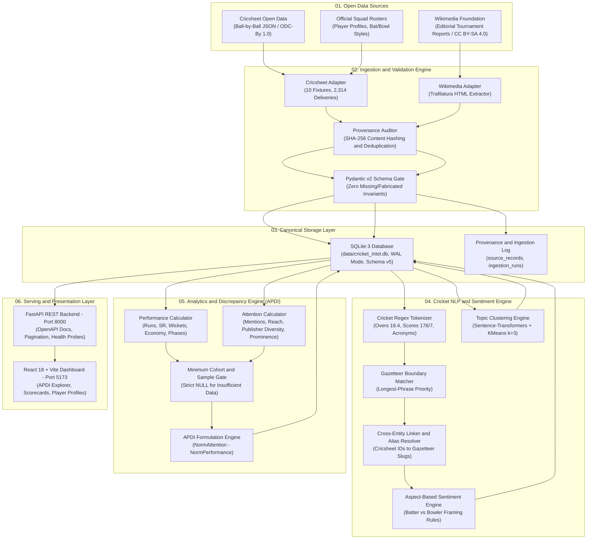
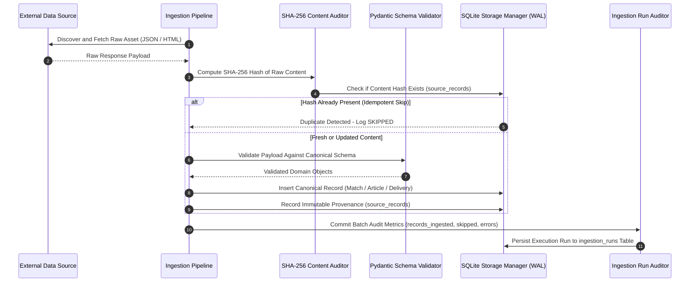
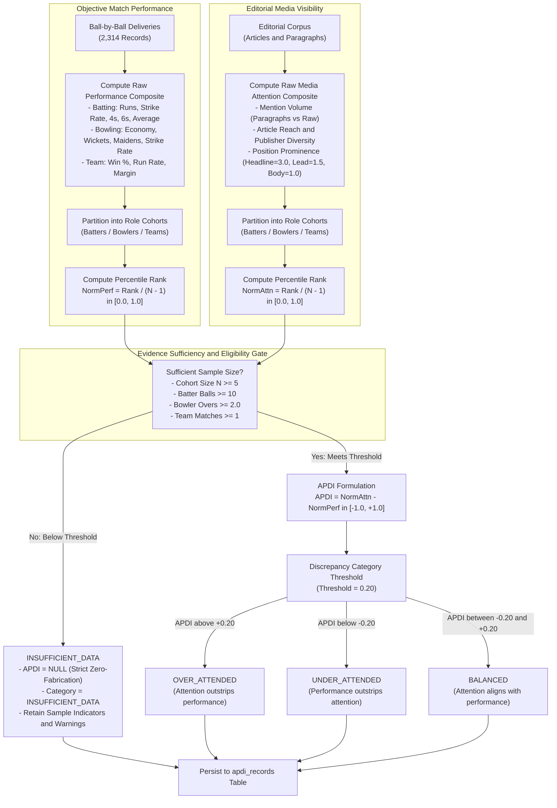
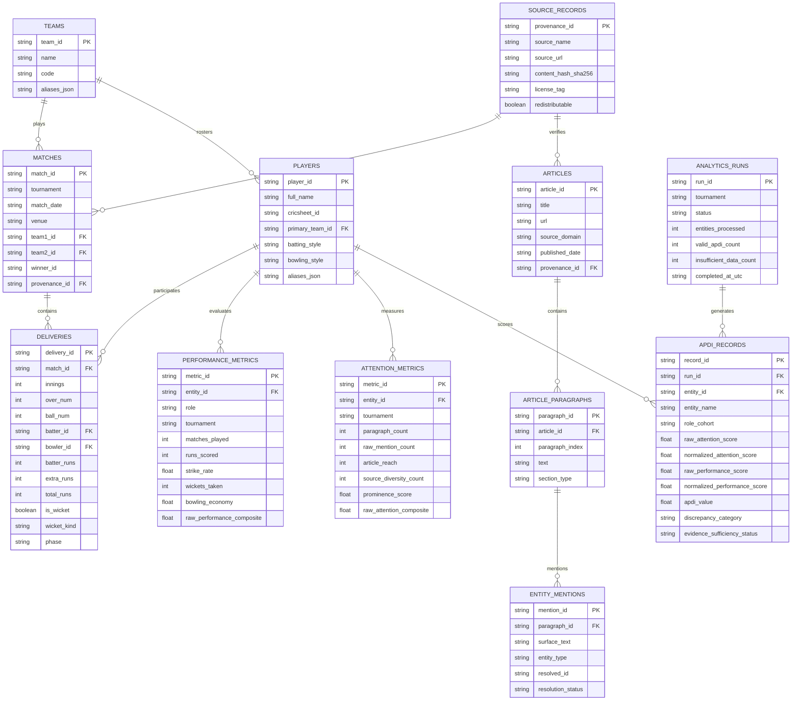
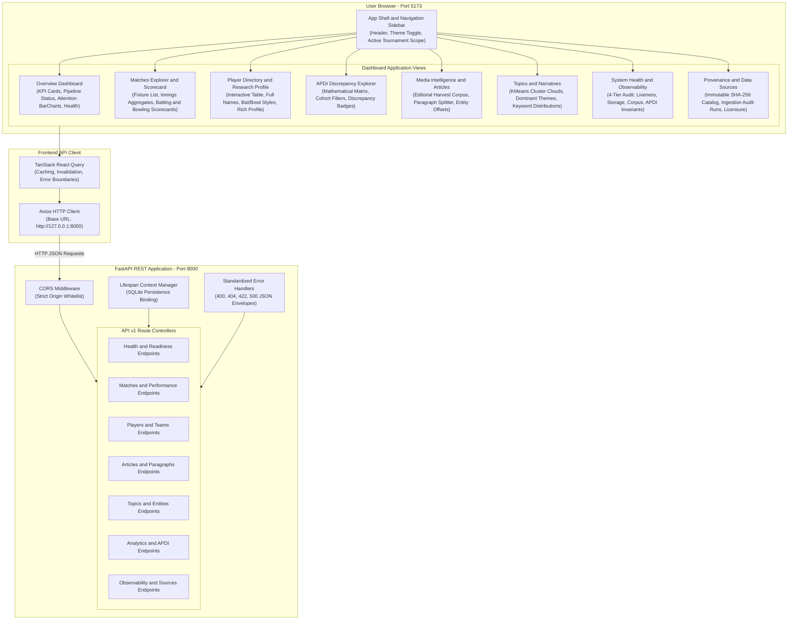
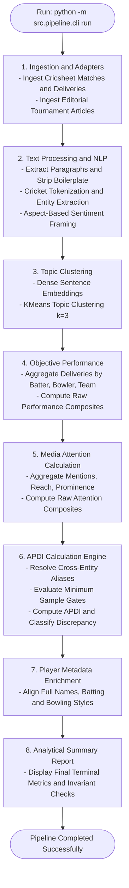

# T20 Cricket Intelligence Platform
### Open-Source Sports Intelligence, Narrative Discovery & Event Grounding for T20 Cricket

[](https://www.python.org/)
[](https://fastapi.tiangolo.com/)
[](https://react.dev/)
[](https://vitejs.dev/)
[](https://www.sqlite.org/)
[-brightgreen.svg)](https://docs.pytest.org/)
[-brightgreen.svg)](https://vitest.dev/)
[](LICENSE)

An end-to-end sports intelligence and NLP research system that bridges the gap between **unstructured cricket media (news articles, editorial tournament reports, expert analyses)** and **structured match facts (ball-by-ball deliveries, wickets, and match phases from Cricsheet)**.

The platform introduces the **Attention-to-Performance Discrepancy Index (APDI)**, a mathematically rigorous framework quantifying the divergence between editorial media attention prominence and objective on-field athletic output across role cohorts (Batters, Bowlers, Teams).

---

## 📑 Table of Contents

1. [System Architecture](#-system-architecture)
   - [1.1 High-Level End-to-End Architecture](#11-high-level-end-to-end-architecture)
   - [1.2 Ingestion & Provenance Lifecycle Flow](#12-ingestion--provenance-lifecycle-flow)
   - [1.3 Cricket NLP & Entity Resolution Pipeline](#13-cricket-nlp--entity-resolution-pipeline)
   - [1.4 Attention-to-Performance Discrepancy Index (APDI) Architecture](#14-attention-to-performance-discrepancy-index-apdi-architecture)
   - [1.5 Database Schema & Entity Relationship Model](#15-database-schema--entity-relationship-model)
   - [1.6 Full-Stack Application Component Hierarchy](#16-full-stack-application-component-hierarchy)
   - [1.7 CLI Pipeline & Automation Workflow](#17-cli-pipeline--automation-workflow)
2. [Key Verified Metrics](#-key-verified-metrics-icc-mens-t20-world-cup-2024)
3. [Quickstart: Running Locally](#-quickstart-running-locally)
   - [Step 1: Clone Repository & Virtual Environment](#step-1-clone-repository--virtual-environment)
   - [Step 2: Backend Setup & API Launch](#step-2-backend-setup--api-launch)
   - [Step 3: Frontend Dashboard Launch](#step-3-frontend-dashboard-launch)
4. [Running the Autonomous Pipeline](#-running-the-autonomous-pipeline)
5. [Testing & Quality Assurance](#-testing--quality-assurance)
6. [Essential Guides & Documentation](#-essential-guides--documentation)
7. [License & Ethical Compliance](#-license--ethical-compliance)

---

## 🏛️ System Architecture

### 1.1 High-Level End-to-End Architecture



---

### 1.2 Ingestion & Provenance Lifecycle Flow

Every document and match ingested by the platform receives an immutable SHA-256 cryptographic provenance record before persisting to the database.



---

### 1.3 Cricket NLP & Entity Resolution Pipeline

The platform utilizes a cricket-specialized Natural Language Processing pipeline that respects sports-specific numeric formats, boundary rules, and entity aliases.

```mermaid
flowchart LR
    RAW["Raw Editorial Text<br/>(HTML / RSS Articles)"] --> CLEAN["Text Cleaner<br/>- HTML Unescape<br/>- Boilerplate Strip<br/>- Unicode Normalization"]
    
    CLEAN --> TOK["Cricket Tokenizer<br/>- Overs (19.4)<br/>- Scores (176/7)<br/>- Acronyms (IND, SA)"]
    
    TOK --> GAZ["Gazetteer Matcher<br/>- Boundary Anchoring<br/>- Longest-Phrase Priority<br/>- Substring Guard"]
    
    GAZ --> ER["Entity Disambiguator<br/>- Context Linker<br/>- Alias Canonicalization<br/>- Ambiguity Flagging"]
    
    ER --> MENT["entity_mentions<br/>(Resolved IDs, Character Spans)"]
    
    MENT --> SENT["Aspect Sentiment Engine<br/>- Negation Windowing<br/>- Batter vs Bowler Context<br/>- Domain Lexicons"]
    
    SENT --> FRAME["sentiment_baselines<br/>(Framing Scores, Publisher Breakdown)"]
```



---

### 1.4 Attention-to-Performance Discrepancy Index (APDI) Architecture

The APDI formula mathematically measures divergence between editorial media attention and objective athletic performance across standardized role cohorts (Batters, Bowlers, Teams).



---

### 1.5 Database Schema & Entity Relationship Model

The underlying SQLite database (`data/cricket_intel.db`, Schema Version 5) strictly enforces foreign-key relationships, transactional guarantees, and WAL mode.



---

### 1.6 Full-Stack Application Component Hierarchy

The platform provides a dual-surface architecture: a high-throughput FastAPI REST API serving typed JSON contracts, and a responsive React 18 / Vite single-page dashboard.



---

### 1.7 CLI Pipeline & Automation Workflow

The platform provides a modular CLI interface (`python -m src.pipeline.cli`) capable of running isolated subtasks or executing the complete automated cascade.



---

## 📊 Key Verified Metrics (ICC Men's T20 World Cup 2024)

| Entity / Dimension | Verified Benchmark Count | Integrity & Verification Method |
| :--- | :---: | :--- |
| **Tournament Fixtures** | **10 Matches** | 100% exact parity with raw Cricsheet JSON; verified in `validate_raw_matches_against_db.py`. |
| **Ball-by-Ball Records** | **2,314 Deliveries** | Complete delivery facts: runs, extras, wickets, bowler/batter assignments, overs, and phases. |
| **Player Registry** | **107 Players** | Canonical identities enriched with batting styles, bowling styles, Cricsheet IDs, and aliases. |
| **Team Registry** | **9 Teams** | Canonical international squads (`IND`, `SA`, `AUS`, `ENG`, `PAK`, `CAN`, `BAN`, `UNI`, `AFG`). |
| **Editorial Documents** | **5 Articles** | Harvested from Wikimedia Foundation under CC BY-SA 4.0; 314 structured paragraphs. |
| **Entity Mentions** | **683 Mentions** | Disambiguated and bound to canonical player/team IDs using longest-phrase gazetteer matching. |
| **Topic Clusters** | **3 Clusters** | Identified via Sentence Transformers + KMeans ($k=3$): Rivalry History, Match Events, Rosters. |
| **Performance Evaluated** | **162 Cohorts** | Objective batting, bowling, and team performance metrics calculated strictly from deliveries. |
| **Attention Evaluated** | **23 Entities** | Granular prominence, article reach, and publisher diversity computed across media passages. |
| **APDI Evaluations** | **116 Total** | **13 Valid classified** (7 Balanced, 3 Over-Attended, 3 Under-Attended) + **103 Preserved NULL** (`INSUFFICIENT_DATA`). |
| **Test Suite Coverage** | **121 / 121 Tests** | **112 backend tests** (`pytest`) + **9 frontend tests** (`vitest`) + 0 TypeScript errors. |

---

## ⚡ Quickstart: Running Locally

Follow these instructions to set up and launch the entire platform from scratch on any machine.

### Step 1: Clone Repository & Virtual Environment

```bash
# Clone the repository
git clone https://github.com/Ritesh-panda/T20-Cricket-Intelligence-Platform.git
cd T20-Cricket-Intelligence-Platform

# Create Python virtual environment
python -m venv .venv

# Activate virtual environment
# On Windows (PowerShell):
.venv\Scripts\Activate.ps1
# On Linux / macOS:
source .venv/bin/activate
```

### Step 2: Backend Setup & API Launch

```bash
# Install all required Python dependencies
pip install -r requirements.txt

# Start the FastAPI backend server (runs on http://127.0.0.1:8000)
python -m uvicorn src.api.main:app --host 127.0.0.1 --port 8000 --reload
```

> **Interactive API Documentation:** Open your browser and navigate to **[http://127.0.0.1:8000/docs](http://127.0.0.1:8000/docs)** for interactive Swagger UI docs.

### Step 3: Frontend Dashboard Launch

In a new terminal window:

```bash
# Navigate to the frontend directory
cd frontend

# Install frontend npm dependencies
npm install

# Start the Vite development server (runs on http://127.0.0.1:5173)
npm run dev
```

> **Live Dashboard:** Open your browser and navigate to **[http://127.0.0.1:5173/](http://127.0.0.1:5173/)** to access the research dashboard.

---

## 🚀 Running the Autonomous Pipeline

The repository includes a ready-to-run benchmark database (`data/cricket_intel.db`). If you wish to re-execute any stage or the entire pipeline end-to-end, use the CLI commands:

```bash
# Execute the entire intelligence cascade end-to-end
python -m src.pipeline.cli run

# Or execute individual pipeline stages independently:

# 1. Harvest & ingest raw tournament fixtures and editorial articles
python -m src.pipeline.cli ingest

# 2. Extract paragraphs, tokenize, and perform entity resolution & sentiment
python -m src.pipeline.cli process-text

# 3. Discover topic clusters and keyword groupings
python -m src.pipeline.cli cluster-topics --k 3

# 4. Compute objective player and team performance from deliveries
python -m src.pipeline.cli compute-performance

# 5. Compute editorial media attention and prominence scores
python -m src.pipeline.cli compute-attention

# 6. Compute Attention-to-Performance Discrepancy Index (APDI)
python -m src.pipeline.cli compute-apdi --tournament "ICC Men's T20 World Cup"

# 7. Print comprehensive terminal intelligence report
python -m src.pipeline.cli report
```

---

## 🧪 Testing & Quality Assurance

The codebase includes an exhaustive automated test suite validating every tier of the application:

```bash
# 1. Run all backend tests (112 tests covering Ingestion, NLP, Analytics, API, and Storage)
pytest -v

# 2. Run frontend unit and integration tests (9 tests)
cd frontend
npm run test

# 3. Run frontend TypeScript type safety check (0 errors)
npm run typecheck

# 4. Build frontend production distribution bundle
npm run build
cd ..

# 5. Run raw-match ball-by-ball parity validation script
python scripts/validate_raw_matches_against_db.py

# 6. Run APDI threshold sensitivity analysis
python scripts/phase9_apdi_sensitivity.py

# 7. Run NLP gold-standard evaluation benchmark
python scripts/evaluate_nlp_gold_set.py
```

---

## 📚 Essential Guides & Documentation

- 📖 **[USER_GUIDE.md](docs/USER_GUIDE.md)**: **Complete User Manual** covering setup, UI walkthrough (Scorecards, Player Profiles, APDI Explorer, Observability), API reference, and APDI interpretation.
- 🧪 **[TESTING_AND_QA_GUIDE.md](docs/TESTING_AND_QA_GUIDE.md)**: **Complete Tester's Specification & Function Guide** detailing test execution, function-by-function testing reference, invariants, edge cases, and QA acceptance checklists.
- 📐 **[PHASE_9_APDI_METHODOLOGY.md](docs/PHASE_9_APDI_METHODOLOGY.md)**: In-depth mathematical formulation, ranking properties, and numerical sensitivity analysis of the APDI metric.
- ⚖️ **[PHASE_9_SOURCE_LEGALITY_AUDIT.md](docs/PHASE_9_SOURCE_LEGALITY_AUDIT.md)**: Exhaustive compliance audit of all data sources across 11 legal dimensions.
- 📋 **[PHASE_9_RELEASE_CHECKLIST.md](docs/PHASE_9_RELEASE_CHECKLIST.md)**: Item-by-item release verification and research integrity sign-offs.

---

## 📜 License & Ethical Compliance

- **Structured Cricket Data**: Provided by [Cricsheet](https://cricsheet.org/) under the [Open Data Commons Attribution License (ODC-By 1.0)](https://opendatacommons.org/licenses/by/1-0/).
- **Editorial Summaries**: Sourced from [Wikipedia / Wikimedia Foundation](https://en.wikipedia.org/) under [Creative Commons Attribution-ShareAlike 4.0 (CC BY-SA 4.0)](https://creativecommons.org/licenses/by-sa/4.0/).
- **Ethical Web Scraping Protocol**: The platform adheres strictly to `robots.txt` directives and rate limits. Commercial publishers with restrictive terms (ESPNcricinfo, Cricbuzz, Wisden) are categorized as `RESTRICTED` and withheld from automated web harvesting.
