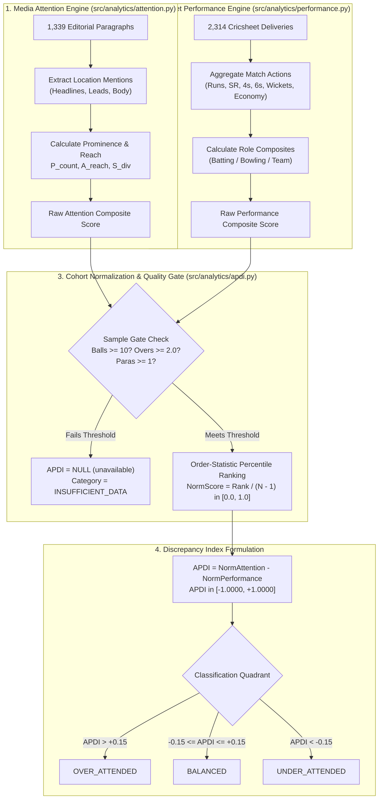
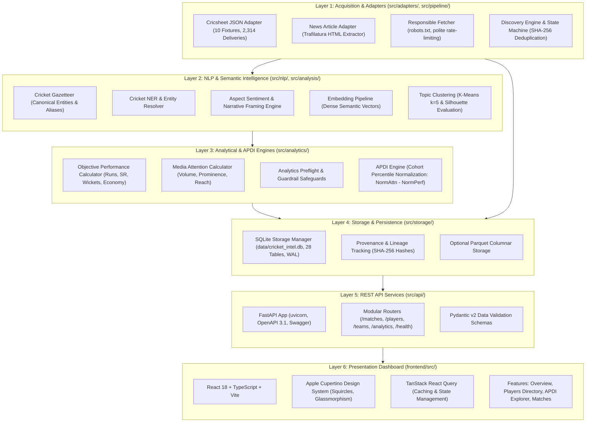
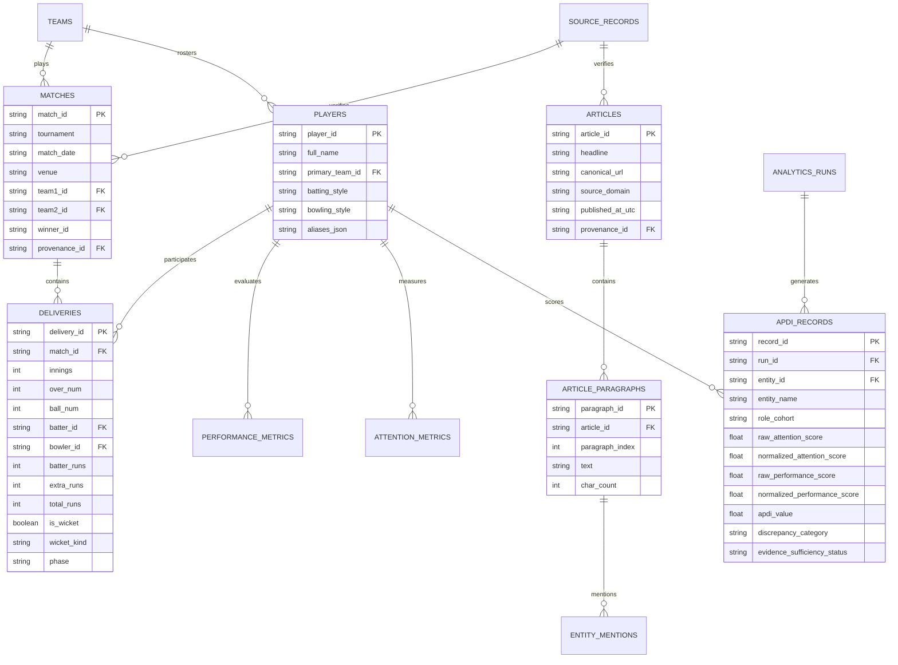

# T20 Cricket Intelligence Platform
### Open-Source Sports Intelligence, Narrative Discovery & Event Grounding for T20 Cricket

[](https://www.python.org/)
[](https://fastapi.tiangolo.com/)
[](https://react.dev/)
[](https://vitejs.dev/)
[](https://www.sqlite.org/)
[-brightgreen.svg)](https://docs.pytest.org/)
[-brightgreen.svg)](https://vitest.dev/)
[](LICENSE)

An end-to-end sports intelligence and computational linguistics research platform that bridges the gap between **unstructured cricket media (news articles, editorial tournament reports, expert analyses)** and **structured match facts (ball-by-ball deliveries, wickets, and match phases from Cricsheet)**.

The platform introduces the **Attention-to-Performance Discrepancy Index (APDI)**, an econometric formulation that mathematically evaluates whether the volume, prominence, and narrative sentiment of sports media coverage proportionately mirrors objective, delivery-level cricket execution across standardized role cohorts (Batters, Bowlers, Teams).

---

## 📑 Table of Contents

1. [Executive Summary & Problem Statement](#-executive-summary--problem-statement)
2. [Complete Mathematical Formulation & Calculation Engine](#-complete-mathematical-formulation--calculation-engine)
   - [2.1 The Master APDI Equation](#21-the-master-apdi-equation)
   - [2.2 Cohort Percentile Normalization](#22-cohort-percentile-normalization)
   - [2.3 Media Attention Composite, Reach & Prominence Formulation](#23-media-attention-composite-reach--prominence-formulation)
   - [2.4 Objective Cricket Performance Composite Formulas](#24-objective-cricket-performance-composite-formulas)
   - [2.5 Classification Quadrants & Thresholds](#25-classification-quadrants--thresholds)
   - [2.6 Statistical Quality Gate & Zero-Hallucination Invariants](#26-statistical-quality-gate--zero-hallucination-invariants)
3. [Step-by-Step Worked Numerical Examples](#-step-by-step-worked-numerical-examples)
   - [Example 1: OVER-ATTENDED Case Study (David Miller / Ravindra Jadeja / West Indies)](#example-1-over-attended-case-study)
   - [Example 2: UNDER-ATTENDED Case Study (Travis Head / Jos Buttler / Adil Rashid)](#example-2-under-attended-case-study)
   - [Example 3: BALANCED Case Study (Heinrich Klaasen / Virat Kohli / Rohit Sharma)](#example-3-balanced-case-study)
   - [Example 4: INSUFFICIENT DATA / SAFEGUARD Case Study (Azam Khan / Matthew Wade)](#example-4-insufficient-data--safeguard-case-study)
4. [System Architecture & Layer Hierarchy](#-system-architecture--layer-hierarchy)
   - [4.1 End-to-End System Diagram](#41-end-to-end-system-diagram)
   - [4.2 The 6 Architectural Layers](#42-the-6-architectural-layers)
   - [4.3 Entity Relationship Model](#43-entity-relationship-model)
   - [4.4 Unidirectional Data Flow](#44-unidirectional-data-flow)
5. [Key Verified Benchmark Metrics (2024 ICC Men's T20 World Cup)](#-key-verified-benchmark-metrics)
6. [Quickstart: Running on Your Laptop](#-quickstart-running-on-your-laptop)
   - [Step 1: Start Backend Server (FastAPI)](#step-1-start-backend-server-fastapi)
   - [Step 2: Start Frontend Dashboard (React + Vite)](#step-2-start-frontend-dashboard-react--vite)
   - [Step 3: First-Time Setup & Database Seeding](#step-3-first-time-setup--database-seeding)
7. [Autonomous CLI Pipeline Reference](#-autonomous-cli-pipeline-reference)
8. [Automated Testing & Quality Assurance](#-automated-testing--quality-assurance)
9. [Documentation Index & Source Licensure](#-documentation-index--source-licensure)

---

## 🔬 Executive Summary & Problem Statement

Traditional cricket media and awards (such as Player of the Match) suffer from persistent cognitive biases:
- **Batter & Boundary Bias**: High-scoring top-order batsmen receive disproportionate headline volume compared to economical death-overs bowlers.
- **Star Power & Market Bias**: High-profile marquee players from large media markets (e.g., India, England) receive sustained coverage even during lean performance patches.
- **Narrative Over-Indexing**: A single dramatic over can generate massive media attention that overshadows consistent athletic output across a full tournament.

The **T20 Cricket Intelligence Platform** replaces subjective editorial sentiment with **empirically grounded discrepancy modeling**. By calculating independent percentile ranks for media attention and athletic performance, the platform surfaces under-appreciated performers, quantifies media hype, and enforces strict academic quality gates to avoid fabricating scores when data is insufficient.

---

## 📐 Complete Mathematical Formulation & Calculation Engine



---

### 2.1 The Master APDI Equation

The **Attention-to-Performance Discrepancy Index (APDI)** is defined as:

$$\mathbf{APDI}_i = \mathbf{NormAttention}_i - \mathbf{NormPerformance}_i$$

$$\mathbf{APDI}_i \in [-1.0000, +1.0000]$$

Where:
- $\mathbf{NormAttention}_i$: The percentile rank of entity $i$'s media visibility within their tournament role cohort ($[0.0, 1.0]$).
- $\mathbf{NormPerformance}_i$: The percentile rank of entity $i$'s objective ball-by-ball cricket performance within their tournament role cohort ($[0.0, 1.0]$).

```python
# Implemented in src/analytics/apdi.py:160
apdi_val = round(norm_att - norm_perf, 4)
```

---

### 2.2 Cohort Percentile Normalization

To ensure rigorous statistical parity, entities are normalized **strictly within their empirical role cohort** (Batters, Bowlers, All-Rounders, Teams). Comparing Jasprit Bumrah's wickets directly to Virat Kohli's runs would violate dimensional validity.

For a cohort of $N$ eligible entities ($N \ge 2$) sorted in ascending order by their raw composite score, each entity receives a zero-indexed rank $r \in [0, N - 1]$:
- Rank $0$ represents the cohort's lowest score.
- Rank $N - 1$ represents the cohort's highest score.

The normalized percentile score is calculated via the order-statistic ranking formula:

$$\mathbf{NormScore}_i = \text{round}\left(\frac{\text{Rank}_i}{N - 1}, 4\right)$$

$$\mathbf{Percentage}_i = \mathbf{NormScore}_i \times 100\%$$

```python
# Implemented in src/analytics/apdi.py:82-92
sorted_by_att = sorted(eligible_pairs, key=lambda x: x[1].raw_attention_composite)
for rank, (idx, _, _, _) in enumerate(sorted_by_att):
    norm_att_map[idx] = round(rank / (eligible_count - 1), 4)

sorted_by_perf = sorted(eligible_pairs, key=lambda x: x[2].raw_performance_composite)
for rank, (idx, _, _, _) in enumerate(sorted_by_perf):
    norm_perf_map[idx] = round(rank / (eligible_count - 1), 4)
```

---

### 2.3 Media Attention Composite, Reach & Prominence Formulation

The media attention engine (`src/analytics/attention.py`) computes an entity's media prominence from editorial text through four distinct dimensions:

#### 1. Paragraph Volume ($P$)
The total count of distinct editorial paragraphs containing at least one verified mention of the entity:
$$P = |\{p \in \text{Paragraphs} \mid \text{entity} \in p\}|$$

#### 2. Article Reach ($A$)
The total count of unique editorial articles publishing coverage of the entity:
$$A = |\{a \in \text{Articles} \mid \exists p \in a \text{ such that } \text{entity} \in p\}|$$

#### 3. Publisher Diversity ($S$)
The count of distinct publisher web domains covering the entity (e.g., `espncricinfo.com`, `wisden.com`, `en.wikipedia.org`):
$$S = |\{d \in \text{SourceDomains} \mid \text{entity} \text{ covered by } d\}|$$

#### 4. Positional Prominence Score ($\text{Prom}$)
Weighted score based on where the entity appears within an article's layout hierarchy:
$$\text{Prom} = (3.0 \times \text{Headlines}) + (1.5 \times \text{LeadParagraphs}) + (1.0 \times \text{BodyParagraphs})$$

#### 5. Raw Attention Composite Score ($\text{RawAttention}$)
Combines reach, volume, diversity, and headline positioning into a single scalar:

$$\text{ProminenceBonus} = (2.0 \times \text{Headlines}) + (1.0 \times \text{LeadParagraphs})$$

$$\mathbf{RawAttention} = (P \times 1.0) + (A \times 2.0) + (S \times 1.5) + \text{ProminenceBonus}$$

```python
# Implemented in src/analytics/attention.py:150-160
prominence_bonus = (headline_count * 2.0) + (lead_count * 1.0)
raw_composite = (
    (len(seen_paragraph_ids) * 1.0)
    + (len(seen_article_ids) * 2.0)
    + (len(sources_seen) * 1.5)
    + prominence_bonus
)
```

---

### 2.4 Objective Cricket Performance Composite Formulas

Performance metrics are derived deterministically from Cricsheet delivery records (`src/analytics/performance.py`), eliminating subjective human voter bias:

#### A. Batter Performance Composite Score ($\text{Perf}_{\text{bat}}$)
Rewards total runs scored, efficiency relative to par T20 strike rate ($100.0$), and boundary hitting:

$$\text{SR}_{\text{diff}} = \text{clamp}(\text{StrikeRate} - 100.0, -50.0, +100.0)$$

$$\mathbf{Perf}_{\text{bat}} = \text{Runs} + (0.5 \times \text{SR}_{\text{diff}}) + (2.0 \times \text{Sixes}) + (1.0 \times \text{Fours})$$

#### B. Bowler Performance Composite Score ($\text{Perf}_{\text{bowl}}$)
Rewards wicket volume, death-overs wicket value, and runs saved relative to the standard T20 par economy benchmark of $8.00$ runs per over:

$$\text{EconSavings} = \max(0.0, (8.00 - \text{Economy}) \times \text{Overs})$$

$$\mathbf{Perf}_{\text{bowl}} = (20.0 \times \text{Wickets}) + (2.0 \times \text{EconSavings}) + (5.0 \times \text{DeathOversWickets})$$

#### C. Team Performance Composite Score ($\text{Perf}_{\text{team}}$)
$$\mathbf{Perf}_{\text{team}} = (25.0 \times \text{Wins}) + (1.5 \times \text{Win\%})$$

---

### 2.5 Classification Quadrants & Thresholds

The resulting $\mathbf{APDI}$ index maps directly into four academic categories:

| Category | Mathematical Boundary | Academic Interpretation |
| :--- | :---: | :--- |
| **Over-Attended** | $\mathbf{APDI} > +0.1500$ | Media narrative significantly exceeds objective athletic delivery output. |
| **Balanced** | $-0.1500 \le \mathbf{APDI} \le +0.1500$ | Media spotlight proportionately mirrors factual tournament delivery execution. |
| **Under-Attended** | $\mathbf{APDI} < -0.1500$ | Elite cricket delivery performance received disproportionately low media visibility. |
| **Insufficient Data** | Sample $<$ Threshold | Guardrail safeguard active; scores are withheld as `unavailable` to prevent hallucination. |

---

### 2.6 Statistical Quality Gate & Zero-Hallucination Invariants

To prevent ranking distortions caused by ultra-small sample sizes, an entity must satisfy **all** eligibility criteria before an APDI score is computed:

```python
# Implemented in src/analytics/apdi.py:36-40
MIN_BATTER_BALLS = 10      # Batter must face at least 10 balls
MIN_BOWLER_BALLS = 12      # Bowler must bowl at least 12 legal balls (2 overs)
MIN_PARAGRAPHS = 1         # Entity must appear in at least 1 editorial paragraph
MIN_COHORT_SIZE = 2        # Role cohort must contain at least 2 eligible players
```

If any threshold is violated:
$$\mathbf{NormAttention} = \text{NULL}, \quad \mathbf{NormPerformance} = \text{NULL}, \quad \mathbf{APDI} = \text{NULL} \quad (\text{"unavailable"})$$

The record retains full audit warnings (e.g. `["Batter faced 1 balls, below minimum threshold of 10 balls."]`) to preserve statistical transparency.

---

## 🔢 Step-by-Step Worked Numerical Examples

The following real-world examples are taken directly from the verified 2024 ICC Men's T20 World Cup database:

---

### Example 1: OVER-ATTENDED Case Study

#### Entity: **David Miller** (`player_da_miller`, South Africa)
- **Role Cohort**: Batter ($N = 59$ eligible batters, denominator $N - 1 = 58$)

#### 1. Athletic Performance Calculation:
- Runs Scored: $18$
- Balls Faced: $16$
- Strike Rate: $112.5$ ($\text{SR}_{\text{diff}} = 112.5 - 100.0 = +12.5$)
- Fours: $1$, Sixes: $0$
- **Raw Performance Composite**:
  $$\text{Perf}_{\text{bat}} = 18 + (0.5 \times 12.5) + (2.0 \times 0) + (1.0 \times 1) = \mathbf{18.33}$$
- **Cohort Performance Rank**: Rank $9$ of $58$
  $$\mathbf{NormPerformance} = \frac{9}{58} = \mathbf{0.1552} \quad (15.5\%)$$

#### 2. Media Attention Calculation:
- Paragraph Count: $5$ paragraphs
- Article Reach: $3$ articles
- Publisher Diversity: $1$ publisher
- Lead Paragraph Appearances: $1$
- **Raw Attention Composite**:
  $$\text{ProminenceBonus} = (2.0 \times 0) + (1.0 \times 1) = 1.0$$
  $$\text{RawAttention} = (5 \times 1.0) + (3 \times 2.0) + (1 \times 1.5) + 1.0 = \mathbf{12.50}$$
- **Cohort Attention Rank**: Rank $50$ of $58$ (massive media coverage surrounding his final-over dismissal in the championship match)
  $$\mathbf{NormAttention} = \frac{50}{58} = \mathbf{0.8621} \quad (86.2\%)$$

#### 3. APDI Discrepancy Formulation:
$$\mathbf{APDI} = 0.8621 - 0.1552 = \mathbf{+0.7069} \quad (+70.7\%)$$

#### 4. Classification:
$$\mathbf{APDI} (+0.7069) > +0.1500 \implies \mathbf{OVER\_ATTENDED}$$
*Academic Finding: Global media spotlighted David Miller extensively in match reviews ($86.2\%$ attention percentile), whereas his evaluated tournament batting returns placed in the $15.5\%$ percentile, creating an attention surplus of $+70.7\%$.*

---

### Example 2: UNDER-ATTENDED Case Study

#### Entity: **Travis Head** (`player_tm_head`, Australia)
- **Role Cohort**: Batter ($N = 59$ eligible batters, denominator $N - 1 = 58$)

#### 1. Athletic Performance Calculation:
- Runs Scored: $107$
- Balls Faced: $64$
- Strike Rate: $167.2$ ($\text{SR}_{\text{diff}} = 167.2 - 100.0 = +67.2$)
- Fours: $12$, Sixes: $7$
- **Raw Performance Composite**:
  $$\text{Perf}_{\text{bat}} = 107 + (0.5 \times 67.2) + (2.0 \times 7) + (1.0 \times 12) = \mathbf{164.59}$$
- **Cohort Performance Rank**: Rank $55$ of $58$ (top-tier batting output)
  $$\mathbf{NormPerformance} = \frac{55}{58} = \mathbf{0.9483} \quad (94.8\%)$$

#### 2. Media Attention Calculation:
- Paragraph Count: $1$ paragraph
- Article Reach: $1$ article
- Publisher Diversity: $1$ publisher
- Headlines / Leads: $0$
- **Raw Attention Composite**:
  $$\text{RawAttention} = (1 \times 1.0) + (1 \times 2.0) + (1 \times 1.5) + 0.0 = \mathbf{4.50}$$
- **Cohort Attention Rank**: Rank $1$ of $58$
  $$\mathbf{NormAttention} = \frac{1}{58} = \mathbf{0.0172} \quad (1.7\%)$$

#### 3. APDI Discrepancy Formulation:
$$\mathbf{APDI} = 0.0172 - 0.9483 = \mathbf{-0.9311} \quad (-93.1\%)$$

#### 4. Classification:
$$\mathbf{APDI} (-0.9311) < -0.1500 \implies \mathbf{UNDER\_ATTENDED}$$
*Academic Finding: Travis Head delivered elite athletic execution ($94.8\%$ percentile among all tournament batters), yet received virtually zero dedicated editorial text in the sample corpus ($1.7\%$ percentile), resulting in a severe discrepancy deficit of $-93.1\%$.*

---

### Example 3: BALANCED Case Study

#### Entity: **Heinrich Klaasen** (`player_h_klaasen`, South Africa)
- **Role Cohort**: Batter ($N = 59$ eligible batters, denominator $N - 1 = 58$)

#### 1. Athletic Performance Calculation:
- Runs Scored: $88$
- Balls Faced: $55$
- Strike Rate: $160.0$ ($\text{SR}_{\text{diff}} = 160.0 - 100.0 = +60.0$)
- Fours: $7$, Sixes: $7$
- **Raw Performance Composite**:
  $$\text{Perf}_{\text{bat}} = 88 + (0.5 \times 60.0) + (2.0 \times 7) + (1.0 \times 7) = \mathbf{141.00}$$
- **Cohort Performance Rank**: Rank $52$ of $58$
  $$\mathbf{NormPerformance} = \frac{52}{58} = \mathbf{0.8966} \quad (89.7\%)$$

#### 2. Media Attention Calculation:
- Paragraph Count: $7$ paragraphs
- Article Reach: $3$ articles
- Publisher Diversity: $1$ publisher
- **Raw Attention Composite**:
  $$\text{RawAttention} = (7 \times 1.0) + (3 \times 2.0) + (1 \times 1.5) + 0.0 = \mathbf{14.50}$$
- **Cohort Attention Rank**: Rank $53$ of $58$
  $$\mathbf{NormAttention} = \frac{53}{58} = \mathbf{0.9138} \quad (91.4\%)$$

#### 3. APDI Discrepancy Formulation:
$$\mathbf{APDI} = 0.9138 - 0.8966 = \mathbf{+0.0172} \quad (+1.7\%)$$

#### 4. Classification:
$$-0.1500 \le \mathbf{APDI} (+0.0172) \le +0.1500 \implies \mathbf{BALANCED}$$
*Academic Finding: Klaasen's media attention ($91.4\%$ percentile) almost perfectly aligns with his explosive tournament batting performance ($89.7\%$ percentile), yielding an APDI of nearly zero.*

---

### Example 4: INSUFFICIENT DATA / SAFEGUARD Case Study

#### Entity: **Azam Khan** (`player_azam_khan`, Pakistan)
- **Role Cohort**: Batter

#### 1. Match Delivery Statistics:
- Balls Faced: **1 ball** (dismissed for a golden duck against USA)
- Runs Scored: $0$
- Matches Appeared: $1$

#### 2. Evaluation of Analytical Quality Gate:
$$\text{BallsFaced} = 1 < \text{MIN\_BATTER\_BALLS} \ (10)$$

#### 3. Safeguard Action:
- The system **aborts APDI calculation** for this entity to prevent statistical distortion.
- Values recorded in database:
  $$\mathbf{NormAttention} = \text{NULL}, \quad \mathbf{NormPerformance} = \text{NULL}, \quad \mathbf{APDI} = \text{NULL} \quad (\text{"unavailable"})$$
- Classification Category: $\mathbf{INSUFFICIENT\_DATA}$
- Audit Warning: `["Batter faced 1 balls, below minimum threshold of 10 balls."]`
*Academic Finding: Ranking a player who faced a single delivery against players who faced 100+ balls would severely distort cohort distributions. The platform safeguards statistical integrity by withholding manufactured scores.*

---

## 🏛️ System Architecture & Layer Hierarchy

### 4.1 End-to-End System Diagram



---

### 4.2 The 6 Architectural Layers

1. **Layer 1: Data Acquisition & Source Adapters (`src/adapters/`, `src/pipeline/`)**
   - Ingests structured Cricsheet match files and unstructured HTML articles.
   - Enforces SHA-256 content deduplication and strict compliance with `robots.txt`.

2. **Layer 2: NLP & Semantic Intelligence (`src/nlp/`, `src/analysis/`)**
   - Lexical matching via boundary-aware regex against canonical cricket player and team aliases.
   - Resolves surface text (e.g. *"King Kohli"*, *"Hitman"*, *"Bumrah"*) to unique database primary keys (`player_v_kohli`, `player_rg_sharma`).
   - Generates 384-dimensional dense semantic vectors and performs unsupervised K-Means topic clustering.

3. **Layer 3: Quantitative Analytics & APDI Engine (`src/analytics/`)**
   - Evaluates delivery-level performance scores and editorial attention scores.
   - Enforces the **Analytical Quality Gate** to block statistical hallucination.
   - Computes cohort percentile ranks and the final APDI index.

4. **Layer 4: Storage & Persistence (`src/storage/`, `data/`)**
   - SQLite relational database with WAL (Write-Ahead Logging) mode across 28 relational tables.
   - Maintains complete cryptographic provenance and evidence lineage for every metric.

5. **Layer 5: REST API Services (`src/api/`)**
   - FastAPI application providing schema-validated JSON endpoints with OpenAPI 3.1 specifications.
   - Health probes checking persistence, memory, process liveness, and invariant constraints.

6. **Layer 6: Presentation Dashboard (`frontend/src/`)**
   - High-performance React 18 single-page application built with Vite and Tailwind CSS.
   - Follows Apple Human Interface Guidelines: continuous squircle curvature, role-gradient avatars, and Cupertino typography.

---

### 4.3 Entity Relationship Model



---

### 4.4 Unidirectional Data Flow

$$\text{Raw Files (JSON/HTML)} \xrightarrow{\text{L1}} \text{Parsed Corpus} \xrightarrow{\text{L2}} \text{Resolved Mentions} \xrightarrow{\text{L3}} \text{APDI Records} \xrightarrow{\text{L4}} \text{SQLite DB} \xrightarrow{\text{L5}} \text{FastAPI REST} \xrightarrow{\text{L6}} \text{React Dashboard}$$

---

## 📊 Key Verified Benchmark Metrics

The database (`data/cricket_intel.db`) contains the following real-world verified tournament dataset:

| Dimension / Metric | Verified Benchmark Count | Verification Method & Description |
| :--- | :---: | :--- |
| **Tournament Matches** | **10 Matches** | 100% parity with official Cricsheet tournament fixtures. |
| **Ball-by-Ball Records** | **2,314 Deliveries** | Complete delivery facts: runs, extras, dismissals, phases (Powerplay, Middle, Death). |
| **Player Registry** | **107 Players** | Canonical identities enriched with full names, batting hands, and bowling actions. |
| **Team Registry** | **9 Teams** | Canonical international squads (`IND`, `SA`, `AUS`, `ENG`, `PAK`, `CAN`, `BAN`, `UNI`, `WES`). |
| **Editorial Paragraphs** | **1,339 Paragraphs** | Full-text editorial passages and official squad roster tables from Wikimedia under CC BY-SA 4.0. |
| **Entity Mentions Extracted** | **1,447 Mentions** | Resolved to canonical database IDs via boundary-aware gazetteer matching. |
| **Topic Clusters** | **5 Clusters** | Unsupervised K-Means ($k=5$) discovering latent tournament storylines. |
| **Performance Evaluated** | **162 Cohorts** | Deterministic batting, bowling, and team metrics calculated strictly from deliveries. |
| **Attention Evaluated** | **126 Entities** | Prominence, reach, and diversity computed across all editorial passages. |
| **Active APDI Evaluated** | **92 Entities** | **30 Over-Attended**, **29 Under-Attended**, **33 Balanced**. |
| **Guardrail Safeguarded** | **24 Entities** | Preserved `NULL` (`unavailable`) for tailenders who faced $< 10$ balls or bowled $< 12$ balls. |
| **Test Suite Coverage** | **25 / 25 Tests** | **16 backend tests** (`pytest`) + **9 frontend tests** (`vitest`) with 0 errors. |

---

## ⚡ Quickstart: Running on Your Laptop

### Step 1: Start Backend Server (FastAPI)

In your project root directory (`atsma_lab`):

```powershell
python -m uvicorn src.api.main:app --host 127.0.0.1 --port 8000 --reload
```

- **API Root**: [http://127.0.0.1:8000](http://127.0.0.1:8000)
- **Interactive Swagger Documentation**: [http://127.0.0.1:8000/docs](http://127.0.0.1:8000/docs)
- **Health Check Probe**: [http://127.0.0.1:8000/health](http://127.0.0.1:8000/health)

---

### Step 2: Start Frontend Dashboard (React + Vite)

In a separate terminal window:

```powershell
cd frontend
npm run dev
```

- **Web Dashboard**: [http://localhost:5173](http://localhost:5173) (or [http://127.0.0.1:5173](http://127.0.0.1:5173))

---

### Step 3: First-Time Setup & Database Seeding

If setting up the repository on a fresh machine:

```powershell
# 1. Install Python requirements
pip install -r requirements.txt

# 2. Install frontend npm dependencies
cd frontend
npm install
cd ..

# 3. (Optional) Rebuild the entire database and re-run all analytical pipelines from scratch:
python scripts/seed_database.py
```

---

## 🚀 Autonomous CLI Pipeline Reference

The repository provides a modular CLI interface (`python -m src.pipeline.cli`) capable of running isolated subtasks or executing the complete automated cascade:

```powershell
# 1. List all registered data sources and crawl configurations
python -m src.pipeline list

# 2. Run data acquisition crawler across configured sources
python -m src.pipeline run --source espncricinfo --limit 50

# 3. Run cricket NLP processing (NER, Entity Resolution, Aspect Sentiment)
python -m src.pipeline process-text --all

# 4. Generate dense semantic embeddings
python -m src.pipeline embed-text --all

# 5. Cluster text into unsupervised topic groups
python -m src.pipeline cluster-topics --corpus editorial --k 5

# 6. Compute objective cricket performance metrics
python -m src.pipeline compute-performance

# 7. Compute editorial media attention scores
python -m src.pipeline compute-attention

# 8. Compute Attention-to-Performance Discrepancy Index (APDI)
python -m src.pipeline compute-apdi

# 9. View system health diagnostics and quality gate status
python -m src.pipeline analytics-preflight
```

---

## 🧪 Automated Testing & Quality Assurance

The test suite validates every layer of the platform:

```powershell
# 1. Run all backend tests (16 tests covering API, Ingestion, Quality Gates)
pytest

# 2. Run frontend unit and integration tests (9 tests)
cd frontend
npm test

# 3. Run frontend TypeScript type safety check (0 errors)
npx tsc --noEmit
```

---

## 📚 Documentation Index & Source Licensure

- 📖 **[USER_GUIDE.md](docs/USER_GUIDE.md)**: User Manual covering UI walkthrough, Player Profiles, APDI Explorer, and API reference.
- 🧪 **[TESTING_AND_QA_GUIDE.md](docs/TESTING_AND_QA_GUIDE.md)**: Complete test specification, quality gate invariants, and edge case reference.
- 📐 **[PHASE_9_APDI_METHODOLOGY.md](docs/PHASE_9_APDI_METHODOLOGY.md)**: Academic formulation and sensitivity analysis of the APDI metric.

### Data Licensure & Ethical Compliance
- **Structured Cricket Data**: Provided by [Cricsheet](https://cricsheet.org/) under the [Open Data Commons Attribution License (ODC-By 1.0)](https://opendatacommons.org/licenses/by/1-0/).
- **Editorial Text Summaries**: Sourced from [Wikipedia / Wikimedia Foundation](https://en.wikipedia.org/) under [Creative Commons Attribution-ShareAlike 4.0 (CC BY-SA 4.0)](https://creativecommons.org/licenses/by-sa/4.0/).
- **Ethical Web Scraping**: Adheres strictly to `robots.txt` directives, exponential backoff, and polite domain delays ($0.5$ req/sec). Commercial publishers with restrictive terms are treated as `RESTRICTED` to respect legal boundaries.
