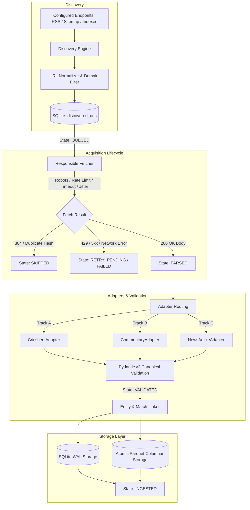
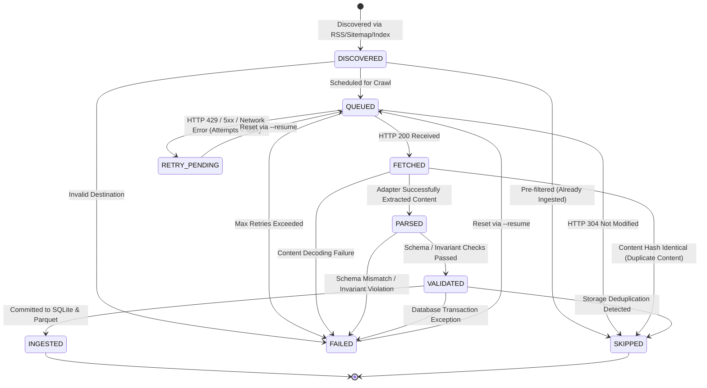

# Acquisition Pipeline, Crawling, Discovery and Idempotent Ingestion

## 1. System Overview

The **T20 Cricket Intelligence Acquisition Pipeline** is a restartable, local-first data harvesting and ingestion engine designed to ingest three independent cricket data streams:

1. **Track A (Structured Match & Delivery Facts)**: Official Cricsheet match datasets in JSON format (v1.0.0 – v1.2.0), providing ground-truth scorecards, delivery events, player registry resolutions, and phase assignments.
2. **Track B (Natural Language Commentary)**: Granular ball-by-ball written commentary feeds parsed via deterministic line grammar and Cricbuzz Next.js streaming payloads, tagged with milestone flags (`FOUR`, `SIX`, `WICKET`, `DRS`, `FIFTY`, `CENTURY`).
3. **Track C (Cricket Journalism & Editorial Essays)**: Match previews, tactical reviews, and post-match analytical reports from permitted publishers (ESPNcricinfo, Wisden), segmented into discrete paragraphs for downstream Named Entity Recognition (NER) and delivery-level event alignment.



---

## 2. Architecture & Modules

The pipeline is implemented under `src/pipeline/` with clean decoupling from adapters and storage:

| Module | Source File | Core Responsibility |
| :--- | :--- | :--- |
| **Source Registry** | [`src/pipeline/config.py`](file:///c:/Users/Ritesh%20Panda/OneDrive/Desktop/atsma_lab/src/pipeline/config.py) | Pydantic configuration schemas, YAML parsing, crawl timestamps, retention policies, domain allowlists. |
| **URL Normalizer** | [`src/pipeline/url_normalizer.py`](file:///c:/Users/Ritesh%20Panda/OneDrive/Desktop/atsma_lab/src/pipeline/url_normalizer.py) | Deterministic canonical URL transformation, marketing parameter removal (`utm_*`, `fbclid`, `ref`), sorting query parameters, fragment stripping, domain allowlist enforcement. |
| **Discovery Engine** | [`src/pipeline/discovery.py`](file:///c:/Users/Ritesh%20Panda/OneDrive/Desktop/atsma_lab/src/pipeline/discovery.py) | Extracts candidate URLs from RSS 2.0/Atom XML feeds, XML sitemaps, sitemap indices, Cricsheet download directories, and approved HTML archives. |
| **Responsible Fetcher** | [`src/pipeline/fetcher.py`](file:///c:/Users/Ritesh%20Panda/OneDrive/Desktop/atsma_lab/src/pipeline/fetcher.py) | Enforces polite rate limits, domain-level robots.txt compliance, bounded retries with exponential backoff & jitter, HTTP 429 `Retry-After` parsing, conditional requests (`ETag` / `Last-Modified`), content-type verification, and response-size limits. |
| **State Machine** | [`src/pipeline/state_machine.py`](file:///c:/Users/Ritesh%20Panda/OneDrive/Desktop/atsma_lab/src/pipeline/state_machine.py) | Explicit 9-state resource lifecycle, legal transition validation, and `DiscoveredUrlRecord` schemas. |
| **Entity Linker** | [`src/pipeline/entity_linker.py`](file:///c:/Users/Ritesh%20Panda/OneDrive/Desktop/atsma_lab/src/pipeline/entity_linker.py) | Conservative, multi-factor heuristic matcher resolving unstructured documents to ground-truth matches via team co-occurrence, date proximity, tournament context, and venue signals. |
| **Orchestrator** | [`src/pipeline/orchestrator.py`](file:///c:/Users/Ritesh%20Panda/OneDrive/Desktop/atsma_lab/src/pipeline/orchestrator.py) | End-to-end execution runner coordinating discovery, fetching, adapter execution, deduplication, revision handling, transactional SQLite persistence, and operational metrics. |
| **CLI & Observability** | [`src/pipeline/cli.py`](file:///c:/Users/Ritesh%20Panda/OneDrive/Desktop/atsma_lab/src/pipeline/cli.py) | Command-line management supporting `list`, `run`, `stats`, `inspect-failed`, `validate`, and guarded `smoke-test`. |

---

## 3. Explicit State Machine

Every discovered URL is tracked in the `discovered_urls` table in SQLite with an explicit lifecycle state:



### Legal State Transitions Map

```python
LEGAL_TRANSITIONS = {
    ResourceState.DISCOVERED: {ResourceState.QUEUED, ResourceState.SKIPPED, ResourceState.FAILED},
    ResourceState.QUEUED: {ResourceState.FETCHED, ResourceState.SKIPPED, ResourceState.RETRY_PENDING, ResourceState.FAILED},
    ResourceState.FETCHED: {ResourceState.PARSED, ResourceState.SKIPPED, ResourceState.RETRY_PENDING, ResourceState.FAILED},
    ResourceState.PARSED: {ResourceState.VALIDATED, ResourceState.SKIPPED, ResourceState.FAILED},
    ResourceState.VALIDATED: {ResourceState.INGESTED, ResourceState.SKIPPED, ResourceState.FAILED},
    ResourceState.RETRY_PENDING: {ResourceState.QUEUED, ResourceState.FAILED, ResourceState.SKIPPED},
    ResourceState.FAILED: {ResourceState.QUEUED},
    ResourceState.SKIPPED: {ResourceState.QUEUED},
    ResourceState.INGESTED: {ResourceState.QUEUED},
}
```

Any attempt to execute an unregistered transition (e.g., `DISCOVERED -> INGESTED` bypassing fetch and validation) immediately raises `IllegalStateTransitionError`.

---

## 4. Idempotency & Revision Management

Repeated pipeline invocations never create duplicate records or leave corrupted states:

### 1. Duplicate Ingestion vs. Legitimate Updates
- **Canonical URL & SHA-256 Fingerprint**: Every resource calculates a SHA-256 fingerprint over its raw payload (`content_hash_sha256`) and clean body text (`raw_content_hash`).
- **Exact Duplicate**: If `canonical_url` and `raw_content_hash` match an existing record in `articles`, the resource is transitioned to `SKIPPED` without reprocessing or mutating existing database IDs.
- **Legitimate Update**: If an article's `canonical_url` matches an existing record but `raw_content_hash` differs (e.g., editorial updates, breaking news expansions), the pipeline:
  1. Records the prior state in `article_revisions` (`revision_id`, `article_id`, `revised_at_utc`, `old_content_hash`, `new_content_hash`, `provenance_id`).
  2. Updates `articles` with the new headline, text, summary, and hash.
  3. Atomically deletes prior paragraphs and inserts revised `article_paragraphs`.
  4. Preserves the stable canonical `article_id`, keeping downstream NER or alignment references intact.

### 2. Match Data Updates
If revised Cricsheet data is ingested for an existing `match_id`:
- `upsert_match` updates scorecard facts and metadata via `ON CONFLICT(match_id) DO UPDATE SET`.
- `replace_deliveries_for_match` atomically purges prior delivery records for that `match_id` and bulk-inserts the refreshed set in a single transaction, preventing duplicate deliveries.

---

## 5. Conservative Entity & Match Linking

The entity linker (`EntityLinker`) connects journalistic articles and commentary passages to ground-truth matches using verifiable multi-signal heuristics:

1. **Team Co-Occurrence (+0.45)**: Both participating teams identified in headline/body.
2. **Date Proximity (+0.15 to +0.35)**: Article publication date matches game date (+0.35 for $\Delta = 0$ days, +0.25 for $\Delta = 1$ day, +0.15 for $\Delta \le 3$ days; penalty for $\Delta > 7$ days).
3. **Tournament Grounding (+0.10 to +0.15)**: Exact tournament name ("ICC Men's T20 World Cup") or acronym found in text.
4. **Venue / Host City (+0.05 to +0.10)**: Match venue or city confirmed.
5. **Threshold & Ambiguity Gate**:
   - Minimum linking confidence: $\ge 0.65$.
   - Ambiguity margin: $\ge 0.15$ gap between top candidate and runner-up.
   - If ambiguous or generic, the record is left **unlinked** (unresolved), ensuring false assertions are never stored.

---

## 6. Operational CLI Commands

The pipeline CLI is invoked via `python -m src.pipeline`:

```bash
# 1. List configured sources, categories, rate limits, and status
python -m src.pipeline list

# 2. Execute dry run for a specific source (discovers, fetches, parses, validates without persistent write)
python -m src.pipeline run --source espncricinfo --dry-run --limit 10

# 3. Execute live ingestion for all enabled sources
python -m src.pipeline run

# 4. Resume failed or retry-pending URLs from previous runs
python -m src.pipeline run --source wisden --resume

# 5. Display per-source ingestion statistics and quality metrics
python -m src.pipeline stats --source espncricinfo

# 6. Inspect failed resources with error diagnostics
python -m src.pipeline inspect-failed --source cricbuzz

# 7. Validate database structural and relational integrity
python -m src.pipeline validate

# 8. Run guarded live smoke test (requires explicit --confirm-live)
python -m src.pipeline smoke-test --source cricsheet --confirm-live
```
