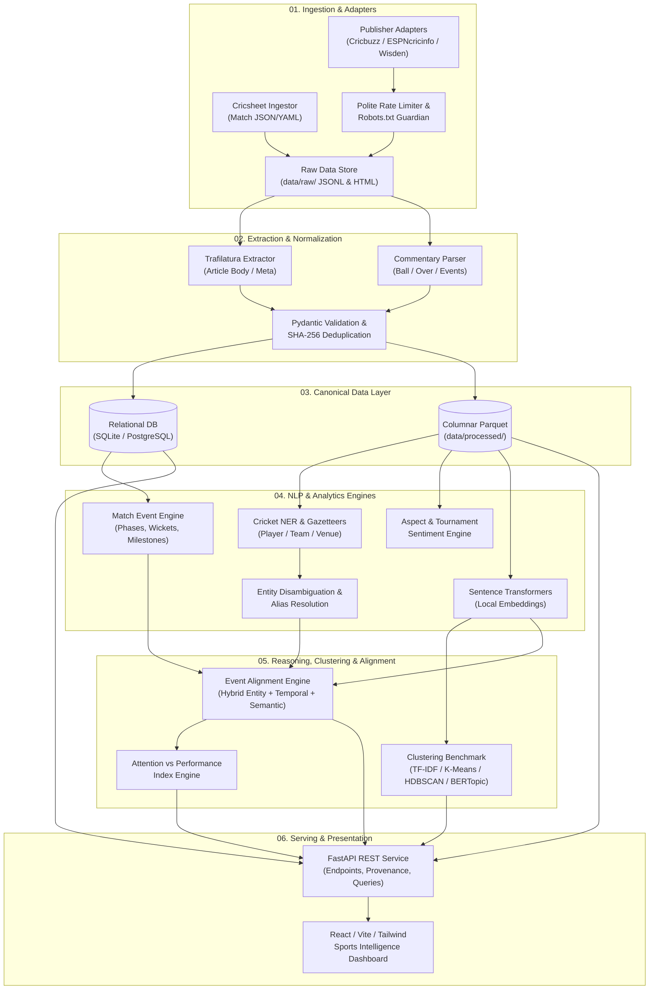

# System Architecture: T20 Cricket Intelligence Platform

## 1. Architectural Overview

The T20 Cricket Intelligence Platform is structured as a decoupled, multi-stage data processing, NLP enrichment, analytical reasoning, and visualization pipeline. 

The core architectural tenet is **strict separation of concerns**:
- Data ingestion adapters do not know how NLP models work.
- NLP pipelines operate strictly on validated, canonical schemas.
- Clustering and topic models produce decoupled, versioned artifacts.
- The web API and dashboard query precomputed or cached analytical entities rather than triggering ad-hoc heavy training.

---

## 2. Component Decomposition & Data Flow



---

## 3. Detailed Module Specifications

### Module A: Source Registry & Adapter Framework
- **Role**: Discovers, fetches, and archives source documents while observing rate limits and robot exclusions.
- **Implemented Classes**:
  - [BaseSourceAdapter](file:///c:/Users/Ritesh%20Panda/OneDrive/Desktop/atsma_lab/src/adapters/base.py#L24-L125): Abstract interface defining polite rate limits, exponential retries, and `is_url_allowed_by_robots()`.
  - [CricsheetAdapter](file:///c:/Users/Ritesh%20Panda/OneDrive/Desktop/atsma_lab/src/adapters/cricsheet_adapter.py#L52-L305): Ingests official Cricsheet match JSON, resolves registry IDs, and reconciles scorecard facts.
  - [CommentaryAdapter](file:///c:/Users/Ritesh%20Panda/OneDrive/Desktop/atsma_lab/src/adapters/commentary_adapter.py#L38-L177): Combines deterministic line grammar parsing with Cricbuzz Next.js JSON streaming payload extraction.
  - [NewsArticleAdapter](file:///c:/Users/Ritesh%20Panda/OneDrive/Desktop/atsma_lab/src/adapters/news_adapter.py#L24-L185): Robust news article extraction using Trafilatura with BeautifulSoup4 DOM fallbacks.
- **Contract**: Accepts source configuration; emits `SourceRecord` containing content SHA-256 fingerprint, license tag, and harvest timestamp.

### Module B: Crawling, Rate Limiting & Storage
- **Role**: Manages polite HTTP requests, exponential backoff, connection pooling, and disk persistence.
- **Implemented Mechanics**:
  - `_enforce_rate_limit()`: Enforces configurable per-domain request rates (default <= 0.5 req/sec).
  - Exponential backoff with jitter on HTTP 429 and 5xx responses.
  - Robots.txt parsing and path verification.

### Module C: Article & Commentary Extraction
- **Role**: Parses unstructured HTML/JSON into normalized text structures.
- **Extraction Stack**:
  - `Trafilatura`: High-precision article text, headline, date, and metadata extraction.
  - `DOM Fallback (BeautifulSoup4 + lxml)`: Tailored CSS selectors for domain-specific markup where Trafilatura fails.
  - `CommentaryTokenizer`: Extracts over number, delivery index, batter, bowler, outcome descriptor, and narrative text.

### Module D: Canonical Validation & Normalization
- **Role**: Enforces uniform typed schemas and rejects corrupt, incomplete, or duplicate records.
- **Validation**: Pydantic v2 schemas in [`src/models/canonical.py`](file:///c:/Users/Ritesh%20Panda/OneDrive/Desktop/atsma_lab/src/models/canonical.py):
  - Strict totals check: `total_runs == batter_runs + extra_runs`.
  - Wicket dismissal check: requires `player_dismissed_id` when `is_wicket=True`.
- **Deduplication**: Content fingerprinting (SHA-256 over clean body text) and unique `canonical_url` constraints.

### Module E: Canonical Storage & Lineage
- **Tier 1 (Raw Archive)**: Immutable audit records in `source_records` table with raw SHA-256 fingerprints.
- **Tier 2 (Relational Metadata)**: [SQLiteStorageManager](file:///c:/Users/Ritesh%20Panda/OneDrive/Desktop/atsma_lab/src/storage/sqlite_manager.py#L182-L390) providing transaction-safe, WAL-mode SQLite tables.
- **Tier 3 (Analytics Datasets)**: [ParquetStorageManager](file:///c:/Users/Ritesh%20Panda/OneDrive/Desktop/atsma_lab/src/storage/parquet_manager.py#L17-L75) providing atomic-write (`.tmp.parquet` -> `.parquet`) columnar datasets under `data/processed/`.
- **Provenance Ledger**: Every row in Tier 2/3 retains `provenance_id` pointing to the exact harvest event.

### Module F: Cricket Named Entity Recognition & Resolution (`src/nlp/`)
- **Text Cleaning & Tokenization**:
  - `CricketTextCleaner`: Normalizes HTML entities, Unicode artifacts, journalistic boilerplate while strictly preserving cricket scores (`182/5`, `82*`), overs (`19.4`), abbreviations (`DRS`, `LBW`), and negation.
  - `CricketTokenizer`: Deterministic regex tokenization supporting overs, scores, compound phrases (`not out`, `death overs`), and acronyms (`T20`, `T20I`, `ODI`, `DLS`).
- **Gazetteer-Guided Boundary NER (`CricketGazetteer`, `CricketNER`)**:
  - Auditable catalog (`config/cricket_gazetteer.yaml`) enriched dynamically from canonical database records (`teams`, `players`).
  - Boundary-aware regex execution (`\b...\b`) with longest-span priority to eliminate accidental substring matches (e.g., prevents matching "SA" inside words or "India" inside unrelated terms).
  - Emits `EntityMentionRecord` with exact character offsets (`start_char`, `end_char`).
- **Entity Resolution Engine (`EntityResolver`)**:
  - Multi-signal candidate ranking separating candidate generation from decision.
  - Contextual disambiguation: boosts ambiguous player candidates by $+0.35$ when their primary team co-occurs in document text.
  - Conservative safety thresholds: requires final score $\ge 0.70$ and margin $\ge 0.15$ above runner-up; otherwise marks mention `AMBIGUOUS` or `UNRESOLVED` to preserve uncertainty without hallucination.

### Module G: Sentiment & Framing Baselines (`src/nlp/sentiment.py`)
- **Interpretable Domain Baselines**:
  - Distinguishes general text tone from cricket event outcome polarity and entity-targeted framing.
  - Bowler vs batter polarity inversion: a wicket is negative for the batting team/batter ($-0.85$), but positive for the bowler ($+0.85$).
  - 3-token negation window: inverts and dampens score when preceded by negation triggers (`did not qualify` $\to$ `NEGATIVE`).
  - Emits `SentimentBaselineRecord` with continuous compound score $[-1.0, +1.0]$, applied rules, and evidence tokens.
  - Fully local, CPU-first, transparent rule/lexicon execution with zero external API dependencies.

### Module H: Clustering & Topic Modeling Pipeline (`src/analysis/`)
- **Interpretable Sparse Baseline (`CricketTfidfBaseline`)**:
  - Word unigrams + bigrams and char n-grams with cricket syntax preservation (`19.4`, `182/5`, `82*`, `DRS`).
- **Dense Clustering Engine (`TopicClusterer`)**:
  - `KMeans`: Fast baseline with fixed random seeds for deterministic cluster reproducibility.
  - `DBSCAN`: Density-based clustering tagging isolated or idiosyncratic editorial narratives as noise (`-1`).
- **Class-Based TF-IDF (`TopicLabeler`)**:
  - Computes c-TF-IDF keyword distributions across aggregated cluster corpora.
  - Generates human-readable labels (e.g. `bumrah-yorker-bowling`) and selects centroid-proximate representative documents.
  - Incoherent or noise clusters explicitly labeled `"Unlabelled Cluster"` or `"Outliers / Noise"`.
- **Clustering Evaluation (`evaluate_topic_clustering`)**:
  - Computes silhouette scores, Davies-Bouldin index, cluster-size distributions, noise fractions, and intra/inter-cluster similarities.

### Module I: Match Analytics & Event Alignment Engine (`src/analysis/`)
- **Event Synthesizer (`EventAlignmentEngine`)**:
  - Aggregates structured ball-by-ball deliveries into notable milestones (wickets, powerplay finishes, death overs $\le 4$ runs, expensive overs $\ge 15$ runs).
  - Evaluates heuristic evidence-backed alignments between editorial paragraphs and match milestones.
- **Two-Stage Cross-Source Matcher (`CrossSourceNarrativeMatcher`)**:
  - Stage 1: Dense/sparse candidate retrieval above threshold.
  - Stage 2: Contextual re-ranking with entity overlap bonus and match facts.
  - Conservative classification: `ACCEPTED` (combined score $\ge 0.50$ + shared entities), `NEEDS_REVIEW` ($0.35 \le s < 0.50$), or `UNRESOLVED` ($< 0.35$).
- **Narrative Timeline Engine (`NarrativeTimelineEngine`)**:
  - Aggregates articles and commentary into chronological buckets.
  - Tracks publication volume, sentiment distributions, topic distributions, and match events.
  - Strictly distinguishes verified observed timestamps from inferred/date-only timestamps.

### Module J: Evaluation & Experiment Tracking
- Logs cluster metrics (Silhouette, Davies-Bouldin, cluster distributions, outlier ratio).
- Logs NER, ER, sentiment, and alignment precision/recall/F1 against deterministic test fixtures.

### Module K: Media Attention vs Performance Analytics Engine (Phase 6A)
- **Media Attention Calculator (`MediaAttentionCalculator`)**:
  - Computes paragraph volume, raw mention occurrences, article reach, source publisher diversity, and structural prominence.
  - Links accepted match narrative alignments and temporal distribution.
- **Cricket Performance Calculator (`CricketPerformanceCalculator`)**:
  - Derived strictly from canonical deliveries and matches.
  - Enforces ICC cricket scoring invariants: legal balls, extras (wides/noballs vs byes/leg-byes), and bowler-credited wickets.
  - Computes role-specific composites and match phase breakdowns (powerplay, middle, death).
- **Narrative Framing Calculator (`NarrativeFramingCalculator`)**:
  - Entity-targeted sentiment breakdown, publisher-level framing variance, and topic cluster intersections.
- **APDI Engine (`APDICalculator`)**:
  - Role-cohort percentile normalization: $\text{PercentileRank} \in [0.0, 1.0]$.
  - Attention-to-Performance Discrepancy Index: $\text{APDI} = \text{NormAttention} - \text{NormPerformance} \in [-1.0, +1.0]$.
  - Discrepancy classification: `OVER_ATTENDED` ($> +0.20$), `UNDER_ATTENDED` ($< -0.20$), `BALANCED` ($[-0.20, +0.20]$), `INSUFFICIENT_DATA`.
  - Quality gates and explainability trace tracking.
- **Preflight Quality Checker (`AnalyticsPreflight`)**:
  - Gatekeeper verifying entity resolution confidence, match reconciliation, and minimum data thresholds.

### Module L: API & Dashboard Architecture (Subphases 6B & 6C)
- **FastAPI Backend**: Provides asynchronous JSON endpoints with automatic OpenAPI documentation.
- **React Frontend**: Built with Vite, TypeScript, and modern data-viz components (Chart.js / Recharts / D3).
- **Local Proxying**: Vite development server proxies `/api` requests to FastAPI at `localhost:8000`.

---

## 4. Local-First Storage Strategy & Directory Layout

```
atsma_lab/
├── .env.example              # Environment variables template
├── .gitignore                # Excludes raw data, research clones, and models
├── README.md                 # Primary project overview
├── config/                   # Configuration files
│   ├── sources.yaml          # Registered source configurations
│   ├── gazetteer.yaml        # Cricket entities, teams, aliases
│   └── models.yaml           # Model hyperparameters & experiment configs
├── data/                     # Data storage (git-ignored)
│   ├── raw/                  # Immutable raw harvest JSONL/HTML
│   ├── interim/              # Validated, deduplicated intermediate records
│   └── processed/            # Parquet files for analytics & ML
├── docs/                     # Design, research & architectural specifications
├── research_sources/         # Cloned external repos for audit (git-ignored)
├── src/                      # Production application source code
│   ├── adapters/             # Ingestion & crawler adapters
│   ├── common/               # Shared utilities, logging, config loaders
│   ├── models/               # Canonical Pydantic & SQLAlchemy schemas
│   ├── nlp/                  # Cleaning, NER, sentiment, embeddings
│   ├── clustering/           # TF-IDF, K-Means, HDBSCAN, BERTopic
│   ├── analytics/            # Event alignment & attention indexes
│   └── api/                  # FastAPI web service
├── tests/                    # Unit, integration, and regression tests
│   ├── fixtures/             # Mock HTML, commentary, and Cricsheet JSON
│   ├── test_adapters.py
│   ├── test_models.py
│   ├── test_nlp.py
│   └── test_alignment.py
└── scripts/                  # Standalone CLI execution utilities
```
