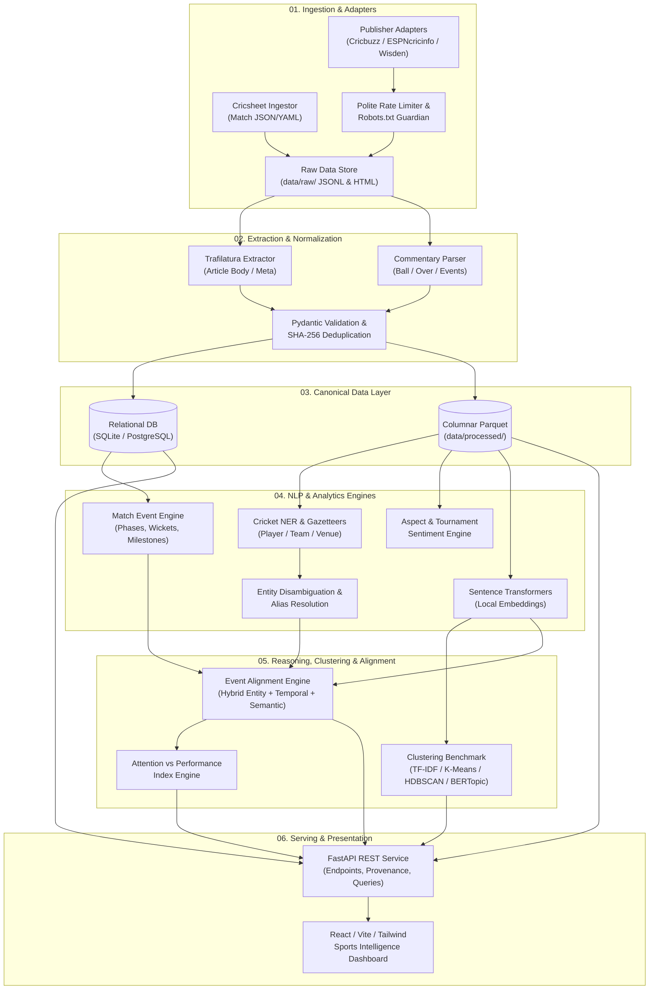

# System Architecture: T20 Cricket Intelligence Platform

## 1. Architectural Overview

The T20 Cricket Intelligence Platform is structured as a decoupled, multi-stage data processing, NLP enrichment, analytical reasoning, and visualization pipeline. 

The core architectural tenet is **strict separation of concerns**:
- Data ingestion adapters do not know how NLP models work.
- NLP pipelines operate strictly on validated, canonical schemas.
- Clustering and topic models produce decoupled, versioned artifacts.
- The web API and dashboard query precomputed or cached analytical entities rather than triggering ad-hoc heavy training.

---

## 2. Component Decomposition & Data Flow



---

## 3. Detailed Module Specifications

### Module A: Source Registry & Adapter Framework
- **Role**: Discovers, fetches, and archives source documents while observing rate limits and robot exclusions.
- **Implemented Classes**:
  - [BaseSourceAdapter](file:///c:/Users/Ritesh%20Panda/OneDrive/Desktop/atsma_lab/src/adapters/base.py#L24-L125): Abstract interface defining polite rate limits, exponential retries, and `is_url_allowed_by_robots()`.
  - [CricsheetAdapter](file:///c:/Users/Ritesh%20Panda/OneDrive/Desktop/atsma_lab/src/adapters/cricsheet_adapter.py#L52-L305): Ingests official Cricsheet match JSON, resolves registry IDs, and reconciles scorecard facts.
  - [CommentaryAdapter](file:///c:/Users/Ritesh%20Panda/OneDrive/Desktop/atsma_lab/src/adapters/commentary_adapter.py#L38-L177): Combines deterministic line grammar parsing with Cricbuzz Next.js JSON streaming payload extraction.
  - [NewsArticleAdapter](file:///c:/Users/Ritesh%20Panda/OneDrive/Desktop/atsma_lab/src/adapters/news_adapter.py#L24-L185): Robust news article extraction using Trafilatura with BeautifulSoup4 DOM fallbacks.
- **Contract**: Accepts source configuration; emits `SourceRecord` containing content SHA-256 fingerprint, license tag, and harvest timestamp.

### Module B: Crawling, Rate Limiting & Storage
- **Role**: Manages polite HTTP requests, exponential backoff, connection pooling, and disk persistence.
- **Implemented Mechanics**:
  - `_enforce_rate_limit()`: Enforces configurable per-domain request rates (default <= 0.5 req/sec).
  - Exponential backoff with jitter on HTTP 429 and 5xx responses.
  - Robots.txt parsing and path verification.

### Module C: Article & Commentary Extraction
- **Role**: Parses unstructured HTML/JSON into normalized text structures.
- **Extraction Stack**:
  - `Trafilatura`: High-precision article text, headline, date, and metadata extraction.
  - `DOM Fallback (BeautifulSoup4 + lxml)`: Tailored CSS selectors for domain-specific markup where Trafilatura fails.
  - `CommentaryTokenizer`: Extracts over number, delivery index, batter, bowler, outcome descriptor, and narrative text.

### Module D: Canonical Validation & Normalization
- **Role**: Enforces uniform typed schemas and rejects corrupt, incomplete, or duplicate records.
- **Validation**: Pydantic v2 schemas in [`src/models/canonical.py`](file:///c:/Users/Ritesh%20Panda/OneDrive/Desktop/atsma_lab/src/models/canonical.py):
  - Strict totals check: `total_runs == batter_runs + extra_runs`.
  - Wicket dismissal check: requires `player_dismissed_id` when `is_wicket=True`.
- **Deduplication**: Content fingerprinting (SHA-256 over clean body text) and unique `canonical_url` constraints.

### Module E: Canonical Storage & Lineage
- **Tier 1 (Raw Archive)**: Immutable audit records in `source_records` table with raw SHA-256 fingerprints.
- **Tier 2 (Relational Metadata)**: [SQLiteStorageManager](file:///c:/Users/Ritesh%20Panda/OneDrive/Desktop/atsma_lab/src/storage/sqlite_manager.py#L182-L390) providing transaction-safe, WAL-mode SQLite tables.
- **Tier 3 (Analytics Datasets)**: [ParquetStorageManager](file:///c:/Users/Ritesh%20Panda/OneDrive/Desktop/atsma_lab/src/storage/parquet_manager.py#L17-L75) providing atomic-write (`.tmp.parquet` -> `.parquet`) columnar datasets under `data/processed/`.
- **Provenance Ledger**: Every row in Tier 2/3 retains `provenance_id` pointing to the exact harvest event.

### Module F: Cricket Named Entity Recognition & Resolution
- **Gazetteer-Guided NER**: Combines spaCy linguistic models with a curated T20 World Cup entity gazetteer (squad rosters, player nicknames, grounds, team acronyms).
- **Entity Resolution Engine**:
  - Fuzzy string matching (Levenshtein distance, Jaro-Winkler).
  - Contextual disambiguation: Resolves identical surnames (e.g., Curran, Sharma, Khan) using co-occurring team names, match dates, or squad lists.
  - Outputs canonical `player_id` (e.g., `cricketer_virat_kohli`) with match confidence score (0.0 to 1.0).

### Module G: Sentiment & Vector Embeddings
- **Domain Sentiment Analysis**:
  - Distinguishes player performance praise/criticism from raw match outcome.
  - Uses VADER / RoBERTa-based sentiment fine-tuned or aspect-mapped to identified entities.
- **Vector Embeddings**:
  - Pre-trained sentence transformers (e.g., `all-MiniLM-L6-v2` or `bge-small-en-v1.5`).
  - Passages and commentary lines are embedded into 384-dimensional unit-normalized vectors.
  - Stored in local memory/cache or Parquet embedding columns for zero-cloud dependency.

### Module H: Clustering & Topic Modeling Pipeline
- **Modular Model Runner**:
  - Pipeline 1: `TfidfVectorizer` + `KMeans` (Lexical baseline).
  - Pipeline 2: `SentenceTransformer` + `KMeans` (Semantic fixed cluster count).
  - Pipeline 3: `SentenceTransformer` + `UMAP` + `HDBSCAN` (Density-based with noise/outlier detection).
  - Pipeline 4: `BERTopic` with class-based TF-IDF (`c-TF-IDF`) for dynamic topic representation and topic reduction.
- **Corpus Segregation**: Commentary and news articles are clustered in isolated pipelines to prevent document-length asymmetry distortions, followed by cross-corpus association.

### Module I: Match Analytics & Event Alignment Engine
- **Event Synthesizer**: Groups Cricsheet deliveries into match milestones (powerplay conclusions, death-over sequences, 3-wicket clusters, half-centuries, turning-point overs).
- **Alignment Algorithmic Heuristic**:
  ```python
  AlignmentScore = (
      0.35 * EntityOverlapScore(article_entities, match_entities) +
      0.30 * TemporalProximityScore(article_timestamp, match_timestamp) +
      0.20 * SemanticSimilarity(article_passage_vector, commentary_window_vector) +
      0.15 * EventKeywordMatch(article_text, delivery_event_keywords)
  )
  ```
- **Explainability Output**: Generates human-readable alignment proofs (e.g., "Linked to Match 38 (IND vs ENG), 16th over because article mentions 'Bumrah yorker', 'dismissal of Livingstone', within 4 hours of match end with 0.88 semantic similarity to commentary").

### Module J: Evaluation & Experiment Tracking
- Logs cluster metrics (Silhouette, Davies-Bouldin, Coherence $C_v$, Outlier ratio).
- Logs NER and alignment Precision, Recall, and F1 against manual gold-standard evaluation sets.

### Module K: API & Dashboard Architecture
- **FastAPI Backend**: Provides asynchronous JSON endpoints with automatic OpenAPI documentation.
- **React Frontend**: Built with Vite, TypeScript, and modern data-viz components (Chart.js / Recharts / D3).
- **Local Proxying**: Vite development server proxies `/api` requests to FastAPI at `localhost:8000`.

---

## 4. Local-First Storage Strategy & Directory Layout

```
atsma_lab/
├── .env.example              # Environment variables template
├── .gitignore                # Excludes raw data, research clones, and models
├── README.md                 # Primary project overview
├── config/                   # Configuration files
│   ├── sources.yaml          # Registered source configurations
│   ├── gazetteer.yaml        # Cricket entities, teams, aliases
│   └── models.yaml           # Model hyperparameters & experiment configs
├── data/                     # Data storage (git-ignored)
│   ├── raw/                  # Immutable raw harvest JSONL/HTML
│   ├── interim/              # Validated, deduplicated intermediate records
│   └── processed/            # Parquet files for analytics & ML
├── docs/                     # Design, research & architectural specifications
├── research_sources/         # Cloned external repos for audit (git-ignored)
├── src/                      # Production application source code
│   ├── adapters/             # Ingestion & crawler adapters
│   ├── common/               # Shared utilities, logging, config loaders
│   ├── models/               # Canonical Pydantic & SQLAlchemy schemas
│   ├── nlp/                  # Cleaning, NER, sentiment, embeddings
│   ├── clustering/           # TF-IDF, K-Means, HDBSCAN, BERTopic
│   ├── analytics/            # Event alignment & attention indexes
│   └── api/                  # FastAPI web service
├── tests/                    # Unit, integration, and regression tests
│   ├── fixtures/             # Mock HTML, commentary, and Cricsheet JSON
│   ├── test_adapters.py
│   ├── test_models.py
│   ├── test_nlp.py
│   └── test_alignment.py
└── scripts/                  # Standalone CLI execution utilities
```
