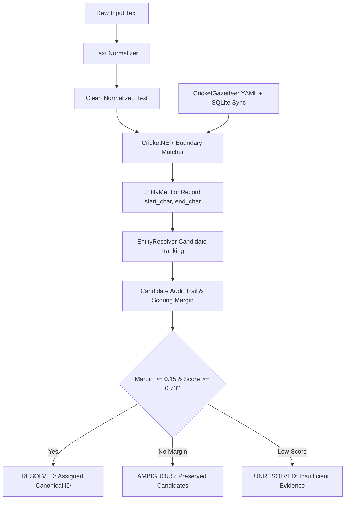

# Cricket Entity Resolution Architecture

## 1. Overview and Problem Statement

Cricket text contains dense, highly ambiguous entity mentions. Surnames (e.g., "Pandya", "Sharma", "Head"), initials, team abbreviations ("IND", "WI", "SA"), and informal nicknames ("Men in Blue", "Aussies") frequently appear in both editorial news and fast-paced live commentary. 

Accidental substring matches (e.g., "India" inside "Indiana" or "SA" inside "SAMPLED") and ambiguous references without context must not be conflated with genuine entity identities. The T20 Cricket Intelligence entity resolution pipeline implements a deterministic, multi-signal, audit-trailed architecture.

---

## 2. Entity Classes and Canonical ID Conventions

The platform registers five core entity types:

| Entity Type | Prefix | Description | Example Canonical ID |
| :--- | :--- | :--- | :--- |
| `PLAYER` | `player_` | International players | `player_virat_kohli`, `player_jasprit_bumrah` |
| `TEAM` | `team_` or ISO code | International & domestic teams | `IND`, `SA`, `AUS`, `ENG` |
| `TOURNAMENT` | `tourn_` | Competitions and tournament editions | `tourn_t20_wc_2024` |
| `VENUE` | `venue_` | International stadia | `venue_kensington_oval` |
| `OFFICIAL` | `official_` | Umpires, match referees, coaches | `official_richard_kettleborough` |

---

## 3. The Cricket Gazetteer (`config/cricket_gazetteer.yaml` & SQLite Sync)

The registry acts as an auditable catalog of aliases with provenance tracking:

1. **Seed YAML Registry** (`config/cricket_gazetteer.yaml`): Curated aliases for key teams, players, tournaments, and venues. Every entry marks whether an alias is inherently ambiguous (e.g., `"Pandya"` is marked `ambiguous: true` because it could refer to Hardik Pandya or Krunal Pandya).
2. **Dynamic SQLite Synchronization**: When connected to the canonical SQLite database, `CricketGazetteer` automatically absorbs all canonical player names, team codes, and JSON aliases stored in `players` and `teams`.
3. **Boundary-Aware Regex Compilation**: All registered aliases are sorted in descending order of character length and compiled into boundary-enforced regular expressions (`rf"\b{re.escape(alias)}\b"`). This guarantees that longer composite phrases (e.g., `"West Indies"`) are matched prior to constituent tokens, preventing false substring matches inside unrelated words.

---

## 4. Multi-Signal Candidate Ranking

The resolution pipeline separates **candidate generation** from **candidate scoring and decision**.

### Candidate Scoring Signals

Each candidate begins with a base score and accumulates evidence signals:

1. **Exact Unambiguous Alias Match**: Base score **0.95**. Assigned when the mention exactly matches a verified unique alias (e.g., `"Virat Kohli"`, `"Men in Blue"`).
2. **Ambiguous Alias Base**: Base score **0.40**. Assigned when an alias is flagged as ambiguous (e.g., surname-only `"Pandya"`).
3. **Exact Canonical ID Match**: Score **0.95**. Assigned when surface text directly matches an ID code (e.g., `"IND"`).
4. **Token Overlap Similarity**: Up to **+0.30** based on character token overlap against candidate full names.
5. **Document Team Context Boost**: **+0.35**. If any co-occurring team mentioned in the surrounding document matches the candidate's `primary_team_id` (e.g., `"India"` appears in an article mentioning `"Pandya"`), the player receives a substantial context boost:
   $$\text{Score} = 0.40 + 0.35 = 0.75$$

---

## 5. Conservative Decision Thresholds and Ambiguity Preservation

To prevent hallucinations and false links:

- **Resolution Threshold**: A candidate must achieve a final score $\ge 0.70$ to be eligible for automatic resolution.
- **Ambiguity Margin**: If multiple candidates exist, the margin between the top score and the runner-up score must be $\ge 0.15$.
  $$\text{Margin} = \text{Score}_{\text{winner}} - \text{Score}_{\text{runner\_up}}$$
- If the margin is $< 0.15$, the status is set to `AMBIGUOUS`. The system does **not** arbitrarily pick a winner; instead, it stores all candidate IDs and scores in the audit trail for human review or downstream contextual re-ranking.
- If the top candidate fails to reach $0.70$, the status is set to `UNRESOLVED`.

---

## 6. Audit Trail and Provenance Storage

Every entity mention and resolution decision is stored with full relational provenance in `entity_mentions` and `entity_resolutions`:

- `mention_id`: Deterministic hash `men_{sha256(source_id + start_char + end_char)[:16]}`.
- `surface_text`: Exact verbatim string from source text.
- `start_char`, `end_char`: Absolute 0-indexed character offsets in the normalized text.
- `resolution_id`: Link to candidate evaluation details in `entity_resolutions`.
- `evidence`: JSON object detailing every applied signal, intermediate score, and decision rationale.
