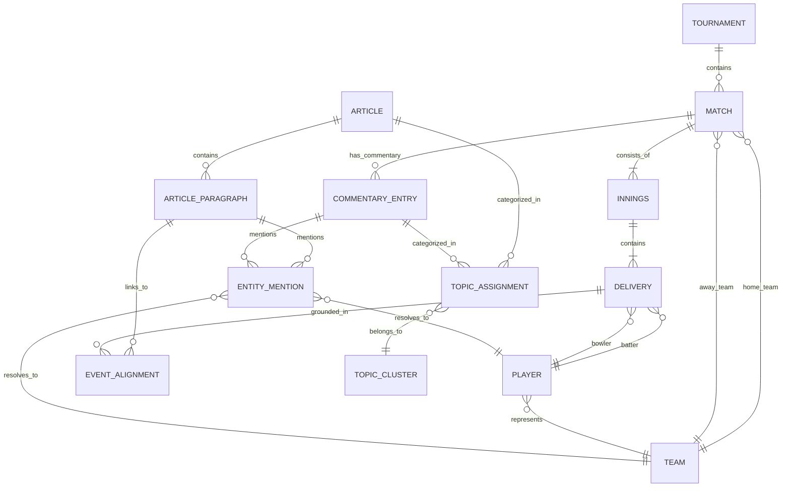

# Canonical Data Model: T20 Cricket Intelligence Platform

## 1. Data Model Philosophy

The platform operates on a **canonical schema layer**. Disparate data sources (Cricsheet JSON, web news articles, commentary live blogs) are converted into standardized, typed entities immediately following extraction.

### Core Modeling Principles
1. **Deterministic Unique Identifiers**:
   - Matches: `cric_{match_id}` or `cric_{date}_{team1}_{team2}`.
   - Players: `player_{clean_first_last}` (e.g., `player_virat_kohli`) resolved via Cricsheet registry.
   - Articles: `art_{sha256(canonical_url)[:16]}`.
   - Commentary: `comm_{match_id}_inn{inn}_ov{over}_b{ball}`.
   - Deliveries: `del_{match_id}_inn{inn}_ov{over}_b{ball}`.
   - Paragraphs: `{article_id}_p{index}`.
   - Alignments: `align_{paragraph_id}_{match_id}_inn{inn}_ov{over}`.
2. **Immutability of Facts**: Match scores and delivery outcomes are ground-truth facts and immutable.
3. **Traceability (Provenance)**: Every text snippet, entity resolution, and sentiment score carries an explicit foreign key (`provenance_id`) referencing an immutable `SourceRecord`.
4. **Validation Gates**: Deliveries enforce `total_runs == batter_runs + extra_runs` and require `player_dismissed_id` when `is_wicket=True`. Articles deduplicate on `canonical_url` and `raw_content_hash`.

---

## 2. Implemented Schema Architecture (`src/models/canonical.py`)

The platform implements 10 core Pydantic v2 models:
- [SourceRecord](file:///c:/Users/Ritesh%20Panda/OneDrive/Desktop/atsma_lab/src/models/canonical.py#L38-L58): Immutable provenance audit record with SHA-256 fingerprinting.
- [IngestionRun](file:///c:/Users/Ritesh%20Panda/OneDrive/Desktop/atsma_lab/src/models/canonical.py#L61-L71): Pipeline execution tracker recording extracted, ingested, and skipped counts.
- [TeamRecord](file:///c:/Users/Ritesh%20Panda/OneDrive/Desktop/atsma_lab/src/models/canonical.py#L74-L86): Canonical team identity with uppercase code and alias lists.
- [PlayerRecord](file:///c:/Users/Ritesh%20Panda/OneDrive/Desktop/atsma_lab/src/models/canonical.py#L89-L98): Canonical player identity with Cricsheet registry ID mapping.
- [DeliveryRecord](file:///c:/Users/Ritesh%20Panda/OneDrive/Desktop/atsma_lab/src/models/canonical.py#L101-L129): Structured delivery outcome with phase categorization (`powerplay`, `middle`, `death`, `super_over`) and strict total run cross-checks.
- [MatchRecord](file:///c:/Users/Ritesh%20Panda/OneDrive/Desktop/atsma_lab/src/models/canonical.py#L132-L151): Ground-truth match scorecard facts and metadata.
- [CommentaryRecord](file:///c:/Users/Ritesh%20Panda/OneDrive/Desktop/atsma_lab/src/models/canonical.py#L154-L168): Ball narrative with automated milestone and event tags (`FOUR`, `SIX`, `WICKET`, `DRS`, `FIFTY`).
- [ArticleRecord](file:///c:/Users/Ritesh%20Panda/OneDrive/Desktop/atsma_lab/src/models/canonical.py#L182-L202): News article document with canonical URL hashing and content SHA-256 deduplication.
- [ArticleParagraphRecord](file:///c:/Users/Ritesh%20Panda/OneDrive/Desktop/atsma_lab/src/models/canonical.py#L171-L179): Discrete paragraph segment for fine-grained NLP and event alignment.
- [EventAlignmentRecord](file:///c:/Users/Ritesh%20Panda/OneDrive/Desktop/atsma_lab/src/models/canonical.py#L205-L217): Traceable semantic link with confidence score and evidence dictionary.

---

## 3. Entity-Relationship Overview

---

## 4. Detailed Entity Schemas (Pydantic / Relational DDL)

### 3.1 Match Fact Layer (Cricsheet / Structured Data)

#### Match Entity (`matches`)
| Field | Type | Description |
| :--- | :--- | :--- |
| `match_id` | String (PK) | Canonical ID (e.g., `cric_1411166` or `match_2024_ind_pak`) |
| `tournament` | String | e.g., `"ICC Men's T20 World Cup 2024"` |
| `season` | String | e.g., `"2024"` |
| `date` | Date | Match start date (UTC) |
| `venue` | String | Stadium name |
| `city` | String | Host city |
| `team1_id` | String (FK) | Reference to `teams.team_id` |
| `team2_id` | String (FK) | Reference to `teams.team_id` |
| `toss_winner_id` | String (FK) | Team that won the toss |
| `toss_decision` | Enum | `"bat"` or `"field"` |
| `winner_id` | String (FK) | Team that won (or null if tie/no-result) |
| `win_by_runs` | Integer | Margin in runs |
| `win_by_wickets` | Integer | Margin in wickets |
| `player_of_match_id`| String (FK) | Reference to `players.player_id` |
| `source_file` | String | Cricsheet source filename |

#### Innings Entity (`innings`)
| Field | Type | Description |
| :--- | :--- | :--- |
| `innings_id` | String (PK) | Format: `{match_id}_inn_{innings_num}` |
| `match_id` | String (FK) | Reference to `matches.match_id` |
| `innings_num` | Integer | 1 or 2 (or 3/4 for super overs) |
| `batting_team_id` | String (FK) | Team batting |
| `bowling_team_id` | String (FK) | Team bowling |
| `total_runs` | Integer | Total runs scored |
| `total_wickets` | Integer | Total wickets lost |
| `total_overs` | Float | Overs faced (e.g. 19.4) |

#### Delivery Entity (`deliveries`)
| Field | Type | Description |
| :--- | :--- | :--- |
| `delivery_id` | String (PK) | Format: `del_{match_id}_{inn}_{over}_{ball}` |
| `match_id` | String (FK) | Reference to `matches.match_id` |
| `innings_id` | String (FK) | Reference to `innings.innings_id` |
| `over_number` | Integer | 0 to 19 (or 1 to 20 depending on 0-index/1-index convention; standardized 1-20) |
| `ball_number` | Integer | Ball within over (1 to 6+, accounting for extras) |
| `batter_id` | String (FK) | Reference to `players.player_id` |
| `bowler_id` | String (FK) | Reference to `players.player_id` |
| `non_striker_id` | String (FK) | Reference to `players.player_id` |
| `batter_runs` | Integer | Runs scored from the bat (0, 1, 2, 3, 4, 6) |
| `extra_runs` | Integer | Wides, no-balls, byes, leg-byes |
| `extra_type` | String | Nullable: `"wides"`, `"noballs"`, `"byes"`, `"legbyes"`, `"penalty"` |
| `is_wicket` | Boolean | True if a dismissal occurred |
| `wicket_type` | String | `"bowled"`, `"caught"`, `"lbw"`, `"run out"`, `"stumped"`, etc. |
| `player_dismissed_id` | String (FK) | Reference to `players.player_id` |
| `cumulative_runs` | Integer | Innings score after this ball |
| `cumulative_wickets`| Integer | Innings wickets down after this ball |

#### Player Entity (`players`)
| Field | Type | Description |
| :--- | :--- | :--- |
| `player_id` | String (PK) | Canonical identifier (e.g., `player_jasprit_bumrah`) |
| `full_name` | String | e.g., `"Jasprit Jasbirsingh Bumrah"` |
| `cricsheet_id` | String | Identifier used by Cricsheet |
| `primary_team_id` | String (FK) | National team identifier |
| `batting_style` | String | e.g., `"Right-hand bat"` |
| `bowling_style` | String | e.g., `"Right-arm fast"` |
| `known_aliases` | JSON/Array | Array of strings: `["J. Bumrah", "Jasprit Bumrah", "Bumrah", "Boom Boom"]` |

---

### 3.2 Unstructured Journalism & Commentary Layer

#### Article Entity (`articles`)
| Field | Type | Description |
| :--- | :--- | :--- |
| `article_id` | String (PK) | Deterministic SHA-256 hash of canonical URL |
| `source_domain` | String | e.g., `"espncricinfo.com"`, `"cricbuzz.com"`, `"wisden.com"` |
| `canonical_url` | String | Cleaned normalized URL |
| `headline` | String | Title extracted from HTML / metadata |
| `author` | String | Byline author or editorial staff |
| `published_at` | Timestamp | Standardized ISO 8601 UTC timestamp |
| `language` | String | ISO 639-1 code (e.g. `"en"`) |
| `article_type` | Enum | `"match_preview"`, `"match_report"`, `"editorial_opinion"`, `"interview"`, `"tactical_analysis"` |
| `raw_content_hash` | String | SHA-256 hash of extracted clean body text |
| `full_text` | Text | Full article body text |
| `provenance_id` | String | Reference to raw archive file |

#### Article Paragraph Entity (`article_paragraphs`)
| Field | Type | Description |
| :--- | :--- | :--- |
| `paragraph_id` | String (PK) | Format: `{article_id}_p{idx}` |
| `article_id` | String (FK) | Reference to `articles.article_id` |
| `paragraph_index`| Integer | Position in document (0, 1, 2...) |
| `text` | Text | Verbatim paragraph content |
| `char_count` | Integer | Length of paragraph |

#### Commentary Entry Entity (`commentary_entries`)
| Field | Type | Description |
| :--- | :--- | :--- |
| `commentary_id` | String (PK) | Format: `comm_{match_id}_{inn}_{over}_{ball}` |
| `match_id` | String (FK) | Reference to `matches.match_id` |
| `innings_num` | Integer | 1 or 2 |
| `over_number` | Integer | Over number (1 to 20) |
| `ball_number` | Integer | Ball number within the over |
| `bowler_name_raw`| String | Raw text for bowler from source |
| `batter_name_raw`| String | Raw text for batter from source |
| `commentary_text`| Text | Written narrative for this delivery |
| `event_tag` | String | `"FOUR"`, `"SIX"`, `"WICKET"`, `"DOT"`, `"SINGLE"`, `"MILESTONE"` |
| `source_domain` | String | Source publisher |

---

### 3.3 NLP Enrichment & Entity Resolution Layer (Schema Version 3)

Implemented in `src/storage/sqlite_manager.py` (Schema v3) and `src/nlp/schemas.py`:

#### Normalized Text Entity (`normalized_texts`)
| Field | Type | Description |
| :--- | :--- | :--- |
| `norm_id` | String (PK) | Format: `norm_{sha256(source_id + text)[:16]}` |
| `source_type` | String | Source record type: `article`, `article_paragraph`, `commentary` |
| `source_id` | String | Reference ID to parent raw record |
| `raw_text` | Text | Original raw source string |
| `clean_text` | Text | Cleaned, normalized text with preserved cricket syntax |
| `token_count` | Integer | Deterministic token count from `CricketTokenizer` |
| `char_count` | Integer | Clean text length in characters |
| `cleaner_version` | String | e.g. `cricket_cleaner_v1` |
| `created_at` | DateTime | Timestamp of normalization |

#### Entity Mention Entity (`entity_mentions`)
| Field | Type | Description |
| :--- | :--- | :--- |
| `mention_id` | String (PK) | Format: `men_{sha256(source_id + start_char + end_char)[:16]}` |
| `source_type` | String | Reference source type (`article_paragraph`, `commentary`) |
| `source_id` | String | Foreign key to parent record |
| `entity_type` | String | `PLAYER`, `TEAM`, `TOURNAMENT`, `VENUE`, `OFFICIAL` |
| `surface_text` | Text | Exact character sequence extracted from source text |
| `start_char` | Integer | 0-indexed start character offset in clean text |
| `end_char` | Integer | 0-indexed end character offset in clean text |
| `resolved_id` | String (Nullable) | Canonical ID if resolved (e.g., `player_virat_kohli`, `IND`) |
| `resolution_status` | String | `RESOLVED`, `AMBIGUOUS`, `UNRESOLVED`, `REJECTED` |
| `confidence` | Float | Confidence score between 0.0 and 1.0 |
| `resolution_id` | String (Nullable) | Foreign key to detailed `entity_resolutions` evaluation |
| `processing_version`| String | Version string (e.g. `cricket_ner_v1`) |
| `created_at` | DateTime | Extraction timestamp |

#### Entity Resolution Entity (`entity_resolutions`)
| Field | Type | Description |
| :--- | :--- | :--- |
| `resolution_id` | String (PK) | Format: `res_{mention_id}` |
| `mention_id` | String (FK) | Reference to `entity_mentions.mention_id` |
| `candidate_id` | String | Candidate canonical entity ID evaluated |
| `score` | Float | Multi-signal ranking score |
| `is_winner` | Boolean | True if selected as the winning canonical entity |
| `evidence_json` | JSON/Text | Audit trail of signals (exact match, aliases, context boost) |
| `algorithm_version` | String | e.g. `cricket_resolver_v1` |
| `evaluated_at` | DateTime | Evaluation timestamp |

#### Sentiment Baseline Entity (`sentiment_baselines`)
| Field | Type | Description |
| :--- | :--- | :--- |
| `sentiment_id` | String (PK) | Format: `sent_{sha256(source_id + target_entity)[:16]}` |
| `source_type` | String | Source text type (`article_paragraph`, `commentary`) |
| `source_id` | String | Parent text reference ID |
| `target_entity_id` | String (Nullable) | Target player/team ID for aspect framing; null if document-level |
| `sentiment_label` | String | `POSITIVE`, `NEUTRAL`, `NEGATIVE` |
| `compound_score` | Float | Continuous compound score in `[-1.0, +1.0]` |
| `framing_type` | String | `general_editorial`, `batting_outcome`, `bowling_outcome` |
| `evidence_tokens_json`| JSON/Text | Tokens that triggered sentiment scoring |
| `rules_applied_json` | JSON/Text | Specific rules triggered (e.g., `negation_detected`) |
| `model_version` | String | Engine version string (e.g. `cricket_lexicon_baseline_v1`) |
| `created_at` | DateTime | Timestamp of evaluation |

#### NLP Execution Run Entity (`nlp_runs`)
| Field | Type | Description |
| :--- | :--- | :--- |
| `run_id` | String (PK) | Execution run ID (e.g. `nlp_run_20261020_215901_abc123`) |
| `started_at` | DateTime | Start timestamp |
| `completed_at` | DateTime | Completion timestamp |
| `records_processed`| Integer | Total raw records processed |
| `mentions_extracted`| Integer | Total entity mentions extracted |
| `mentions_resolved`| Integer | Number of successfully resolved mentions |
| `sentiment_records_created`| Integer | Number of sentiment records computed |
| `error_count` | Integer | Total errors encountered |
| `status` | String | `COMPLETED` or `FAILED` |
| `notes` | Text | Run configuration notes and filters |

---

### 3.4 Semantic Space & Topic Discovery Layer (Schema Version 4)

Implemented in `src/storage/sqlite_manager.py` (Schema v4) and `src/analysis/analysis_schemas.py`:

#### Embedding Metadata Entity (`embedding_records`)
| Field | Type | Description |
| :--- | :--- | :--- |
| `embedding_id` | String (PK) | Format: `emb_{sha256(norm_id + model_version)[:16]}` |
| `norm_id` | String (FK) | Reference to `normalized_texts.norm_id` |
| `source_type` | String | `article_paragraph` or `commentary` |
| `source_id` | String | Parent text reference ID |
| `model_version` | String | e.g. `test-deterministic-hash-384`, `sentence-transformers/all-MiniLM-L6-v2` |
| `dimension` | Integer | Vector dimension (e.g. 384) |
| `text_hash` | String | SHA-256 hash of clean text at embedding time |
| `is_test_double` | Boolean | True if generated by test double |
| `vector_file_path` | String | Local path to `.npy` or Parquet vector array cache |
| `vector_index` | Integer | Row index in vector storage file |
| `created_at_utc` | DateTime | Timestamp of embedding |

#### Topic Run Entity (`topic_runs`)
| Field | Type | Description |
| :--- | :--- | :--- |
| `run_id` | String (PK) | Format: `topic_run_{timestamp}_{hex}` |
| `corpus_type` | String | `editorial`, `commentary`, `combined` |
| `algorithm` | String | `kmeans`, `dbscan` |
| `n_clusters_requested`| Integer (Nullable) | Requested cluster count $K$ (for KMeans) |
| `n_clusters_found` | Integer | Discovered cluster count (excluding noise) |
| `n_noise_points` | Integer | Outlier documents count |
| `parameters_json` | JSON/Text | Hyperparameters dictionary |
| `silhouette_score` | Float (Nullable) | Silhouette score on non-noise vectors |
| `davies_bouldin_index`| Float (Nullable) | Davies-Bouldin clustering index |
| `created_at_utc` | DateTime | Timestamp of execution |

#### Topic Cluster Entity (`topic_clusters`)
| Field | Type | Description |
| :--- | :--- | :--- |
| `cluster_id` | String (PK) | Format: `{run_id}_c{index}` |
| `run_id` | String (FK) | Reference to `topic_runs.run_id` |
| `cluster_index` | Integer | Cluster index (-1 for noise) |
| `topic_label` | String | Human-readable label from c-TF-IDF (e.g. `bumrah-yorker-bowling`) |
| `keywords_json` | JSON/Text | Array of top salient terms |
| `doc_count` | Integer | Number of assigned documents |
| `representative_doc_ids_json`| JSON/Text | IDs of documents closest to centroid |
| `intra_cluster_similarity` | Float (Nullable) | Mean cosine similarity to centroid |
| `is_noise` | Boolean | True if unassigned outlier cluster |

#### Topic Assignment Entity (`topic_assignments`)
| Field | Type | Description |
| :--- | :--- | :--- |
| `assignment_id` | String (PK) | Format: `assign_{run_id[:12]}_{norm_id[:8]}` |
| `cluster_id` | String (FK) | Reference to `topic_clusters.cluster_id` |
| `norm_id` | String (FK) | Reference to `normalized_texts.norm_id` |
| `source_id` | String | Parent document ID |
| `distance_to_centroid` | Float (Nullable) | Euclidean distance to cluster centroid |
| `membership_score` | Float | Soft membership or similarity score |

---

### 3.5 Cross-Source Similarity & Narrative Timeline Layer (Schema Version 4)

#### Cross-Source Match Entity (`cross_source_matches`)
| Field | Type | Description |
| :--- | :--- | :--- |
| `match_link_id` | String (PK) | Format: `xmatch_{sha256(ed_id + comm_id)[:16]}` |
| `editorial_norm_id` | String | Reference to editorial `normalized_texts.norm_id` |
| `editorial_source_id`| String | Parent article paragraph ID |
| `commentary_norm_id` | String | Reference to commentary `normalized_texts.norm_id` |
| `commentary_source_id`| String | Parent delivery commentary ID |
| `match_id` | String (Nullable) | Ground-truth match ID if linked |
| `similarity_score` | Float | Vector cosine similarity in `[-1.0, +1.0]` |
| `status` | String | `ACCEPTED`, `NEEDS_REVIEW`, `UNRESOLVED` |
| `confidence` | Float | Combined confidence score (semantic + entity bonus) |
| `matching_method` | String | e.g. `two_stage_semantic_and_entity_ranking` |
| `evidence_json` | JSON/Text | Detailed proof with shared actors and match facts |
| `created_at_utc` | DateTime | Timestamp of match evaluation |

#### Narrative Timeline Snapshot Entity (`timeline_snapshots`)
| Field | Type | Description |
| :--- | :--- | :--- |
| `snapshot_id` | String (PK) | Format: `snap_{uuid[:12]}` |
| `bucket_label` | String | Date string (`YYYY-MM-DD`) or match phase |
| `doc_count` | Integer | Total articles in bucket |
| `mean_sentiment` | Float | Mean sentiment score in bucket |
| `sentiment_distribution_json` | JSON/Text | Count of positive, neutral, negative |
| `top_topics_json` | JSON/Text | Dominant topics and counts |
| `top_entities_json` | JSON/Text | Most mentioned entities |
| `match_events_count` | Integer | Co-occurring match events count |
| `observed_timestamps_count` | Integer | Count with verified publication timestamp |
| `inferred_timestamps_count` | Integer | Count with date-level or inferred timestamp |
| `created_at_utc` | DateTime | Snapshot creation timestamp |

---

## 4. Parquet & Columnar Storage File Specifications

For fast analytical queries and ML training runs, data is exported into partitioned Parquet files under `data/processed/`:

1. `matches.parquet`: 1 row per match with core metadata.
2. `deliveries.parquet`: Partitioned by `tournament` and `match_id`. Contains all ball-by-ball facts.
3. `articles.parquet`: Ingested and deduplicated articles with body text, metadata, and document-level sentiment.
4. `paragraphs.parquet`: Partitioned by `source_domain`. Contains paragraph text, vector embeddings (384-float array), and resolved entity IDs.
5. `commentary.parquet`: Partitioned by `match_id`. Contains ball narrative, vector embeddings, and resolved entities.
6. `alignments.parquet`: Cross-source links with confidence scores and evidence fields.
