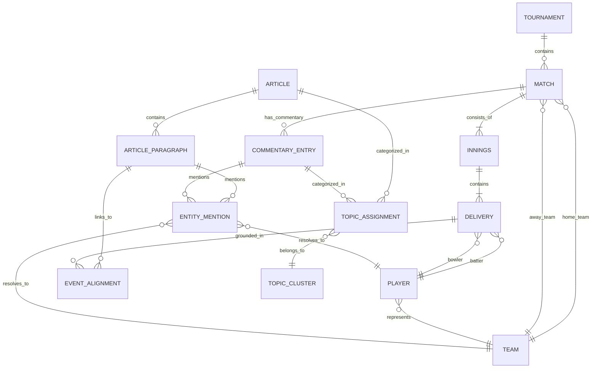

# Canonical Data Model: T20 Cricket Intelligence Platform

## 1. Data Model Philosophy

The platform operates on a **canonical schema layer**. Disparate data sources (Cricsheet JSON, web news articles, commentary live blogs) are converted into standardized, typed entities immediately following extraction.

### Core Modeling Principles
1. **Deterministic Unique Identifiers**:
   - Matches: `match_{tournament}_{date}_{teamA}_{teamB}` (e.g., `match_t20wc2024_20240609_ind_pak`) or Cricsheet match ID.
   - Players: `player_{clean_first_last}` (e.g., `player_jasprit_bumrah`).
   - Articles: `art_{sha256_of_url}`.
   - Commentary: `comm_{match_id}_{innings}_{over}_{ball}`.
   - Deliveries: `deliv_{match_id}_{innings}_{over}_{ball}`.
2. **Immutability of Facts**: Match scores and delivery outcomes are ground-truth facts and immutable.
3. **Traceability (Provenance)**: Every text snippet, entity resolution, and sentiment score carries an explicit foreign key back to its source record and model version.

---

## 2. Entity-Relationship Overview

---

## 3. Detailed Entity Schemas (Pydantic / Relational DDL)

### 3.1 Match Fact Layer (Cricsheet / Structured Data)

#### Match Entity (`matches`)
| Field | Type | Description |
| :--- | :--- | :--- |
| `match_id` | String (PK) | Canonical ID (e.g., `cric_1411166` or `match_2024_ind_pak`) |
| `tournament` | String | e.g., `"ICC Men's T20 World Cup 2024"` |
| `season` | String | e.g., `"2024"` |
| `date` | Date | Match start date (UTC) |
| `venue` | String | Stadium name |
| `city` | String | Host city |
| `team1_id` | String (FK) | Reference to `teams.team_id` |
| `team2_id` | String (FK) | Reference to `teams.team_id` |
| `toss_winner_id` | String (FK) | Team that won the toss |
| `toss_decision` | Enum | `"bat"` or `"field"` |
| `winner_id` | String (FK) | Team that won (or null if tie/no-result) |
| `win_by_runs` | Integer | Margin in runs |
| `win_by_wickets` | Integer | Margin in wickets |
| `player_of_match_id`| String (FK) | Reference to `players.player_id` |
| `source_file` | String | Cricsheet source filename |

#### Innings Entity (`innings`)
| Field | Type | Description |
| :--- | :--- | :--- |
| `innings_id` | String (PK) | Format: `{match_id}_inn_{innings_num}` |
| `match_id` | String (FK) | Reference to `matches.match_id` |
| `innings_num` | Integer | 1 or 2 (or 3/4 for super overs) |
| `batting_team_id` | String (FK) | Team batting |
| `bowling_team_id` | String (FK) | Team bowling |
| `total_runs` | Integer | Total runs scored |
| `total_wickets` | Integer | Total wickets lost |
| `total_overs` | Float | Overs faced (e.g. 19.4) |

#### Delivery Entity (`deliveries`)
| Field | Type | Description |
| :--- | :--- | :--- |
| `delivery_id` | String (PK) | Format: `del_{match_id}_{inn}_{over}_{ball}` |
| `match_id` | String (FK) | Reference to `matches.match_id` |
| `innings_id` | String (FK) | Reference to `innings.innings_id` |
| `over_number` | Integer | 0 to 19 (or 1 to 20 depending on 0-index/1-index convention; standardized 1-20) |
| `ball_number` | Integer | Ball within over (1 to 6+, accounting for extras) |
| `batter_id` | String (FK) | Reference to `players.player_id` |
| `bowler_id` | String (FK) | Reference to `players.player_id` |
| `non_striker_id` | String (FK) | Reference to `players.player_id` |
| `batter_runs` | Integer | Runs scored from the bat (0, 1, 2, 3, 4, 6) |
| `extra_runs` | Integer | Wides, no-balls, byes, leg-byes |
| `extra_type` | String | Nullable: `"wides"`, `"noballs"`, `"byes"`, `"legbyes"`, `"penalty"` |
| `is_wicket` | Boolean | True if a dismissal occurred |
| `wicket_type` | String | `"bowled"`, `"caught"`, `"lbw"`, `"run out"`, `"stumped"`, etc. |
| `player_dismissed_id` | String (FK) | Reference to `players.player_id` |
| `cumulative_runs` | Integer | Innings score after this ball |
| `cumulative_wickets`| Integer | Innings wickets down after this ball |

#### Player Entity (`players`)
| Field | Type | Description |
| :--- | :--- | :--- |
| `player_id` | String (PK) | Canonical identifier (e.g., `player_jasprit_bumrah`) |
| `full_name` | String | e.g., `"Jasprit Jasbirsingh Bumrah"` |
| `cricsheet_id` | String | Identifier used by Cricsheet |
| `primary_team_id` | String (FK) | National team identifier |
| `batting_style` | String | e.g., `"Right-hand bat"` |
| `bowling_style` | String | e.g., `"Right-arm fast"` |
| `known_aliases` | JSON/Array | Array of strings: `["J. Bumrah", "Jasprit Bumrah", "Bumrah", "Boom Boom"]` |

---

### 3.2 Unstructured Journalism & Commentary Layer

#### Article Entity (`articles`)
| Field | Type | Description |
| :--- | :--- | :--- |
| `article_id` | String (PK) | Deterministic SHA-256 hash of canonical URL |
| `source_domain` | String | e.g., `"espncricinfo.com"`, `"cricbuzz.com"`, `"wisden.com"` |
| `canonical_url` | String | Cleaned normalized URL |
| `headline` | String | Title extracted from HTML / metadata |
| `author` | String | Byline author or editorial staff |
| `published_at` | Timestamp | Standardized ISO 8601 UTC timestamp |
| `language` | String | ISO 639-1 code (e.g. `"en"`) |
| `article_type` | Enum | `"match_preview"`, `"match_report"`, `"editorial_opinion"`, `"interview"`, `"tactical_analysis"` |
| `raw_content_hash` | String | SHA-256 hash of extracted clean body text |
| `full_text` | Text | Full article body text |
| `provenance_id` | String | Reference to raw archive file |

#### Article Paragraph Entity (`article_paragraphs`)
| Field | Type | Description |
| :--- | :--- | :--- |
| `paragraph_id` | String (PK) | Format: `{article_id}_p{idx}` |
| `article_id` | String (FK) | Reference to `articles.article_id` |
| `paragraph_index`| Integer | Position in document (0, 1, 2...) |
| `text` | Text | Verbatim paragraph content |
| `char_count` | Integer | Length of paragraph |

#### Commentary Entry Entity (`commentary_entries`)
| Field | Type | Description |
| :--- | :--- | :--- |
| `commentary_id` | String (PK) | Format: `comm_{match_id}_{inn}_{over}_{ball}` |
| `match_id` | String (FK) | Reference to `matches.match_id` |
| `innings_num` | Integer | 1 or 2 |
| `over_number` | Integer | Over number (1 to 20) |
| `ball_number` | Integer | Ball number within the over |
| `bowler_name_raw`| String | Raw text for bowler from source |
| `batter_name_raw`| String | Raw text for batter from source |
| `commentary_text`| Text | Written narrative for this delivery |
| `event_tag` | String | `"FOUR"`, `"SIX"`, `"WICKET"`, `"DOT"`, `"SINGLE"`, `"MILESTONE"` |
| `source_domain` | String | Source publisher |

---

### 3.3 NLP Enrichment & Entity Resolution Layer

#### Entity Mention Entity (`entity_mentions`)
| Field | Type | Description |
| :--- | :--- | :--- |
| `mention_id` | String (PK) | Unique mention identifier |
| `source_type` | Enum | `"article_paragraph"` or `"commentary_entry"` |
| `source_ref_id` | String | FK to `paragraph_id` or `commentary_id` |
| `entity_type` | Enum | `"PLAYER"`, `"TEAM"`, `"VENUE"`, `"PHASE"` |
| `raw_surface_form`| String | Exact text in the document (e.g., `"King Kohli"`) |
| `resolved_entity_id`| String | Resolved canonical ID (e.g., `player_virat_kohli`) |
| `resolution_confidence`| Float | Confidence score between 0.0 and 1.0 |
| `resolution_method`| String | `"exact_match"`, `"alias_gazetteer"`, `"fuzzy_match"`, `"contextual_disambiguation"` |

#### Sentiment Record Entity (`sentiment_records`)
| Field | Type | Description |
| :--- | :--- | :--- |
| `sentiment_id` | String (PK) | Unique record ID |
| `source_type` | Enum | `"article"` or `"article_paragraph"` or `"commentary_entry"` |
| `source_ref_id` | String | Reference ID of parent text |
| `target_entity_id`| String (Nullable) | Target player/team if aspect-based; null if document-level |
| `compound_score` | Float | Continuous score in [-1.0, +1.0] |
| `label` | Enum | `"POSITIVE"`, `"NEUTRAL"`, `"NEGATIVE"` |
| `model_version` | String | Identifier of sentiment engine used (e.g. `vader_cricket_v1`) |

---

### 3.4 Topic Modeling & Semantic Space Layer

#### Topic Cluster Entity (`topic_clusters`)
| Field | Type | Description |
| :--- | :--- | :--- |
| `cluster_id` | String (PK) | Format: `cluster_{experiment_id}_{cluster_num}` |
| `experiment_id` | String | Experiment run identifier (e.g., `exp_bertopic_news_run1`) |
| `corpus_type` | Enum | `"news"` or `"commentary"` or `"joint"` |
| `algorithm` | Enum | `"kmeans_tfidf"`, `"kmeans_embeddings"`, `"hdbscan"`, `"bertopic"` |
| `topic_name` | String | Auto-generated or top-term label (e.g., `"death-overs-bowling-execution"`) |
| `top_keywords` | JSON/Array | Array of objects `[{"term": "yorker", "weight": 0.42}, ...]` |
| `doc_count` | Integer | Number of documents assigned |
| `is_outlier_cluster`| Boolean | True if represents HDBSCAN noise cluster (-1) |

#### Topic Assignment Entity (`topic_assignments`)
| Field | Type | Description |
| :--- | :--- | :--- |
| `assignment_id` | String (PK) | Unique assignment identifier |
| `cluster_id` | String (FK) | Reference to `topic_clusters.cluster_id` |
| `source_ref_id` | String | FK to `article_id` or `commentary_id` |
| `membership_probability`| Float | Soft clustering probability or silhouette score |
| `distance_to_centroid` | Float | Distance in vector space to cluster centroid |

---

### 3.5 Media-to-Match Event Alignment Layer

#### Event Alignment Entity (`event_alignments`)
| Field | Type | Description |
| :--- | :--- | :--- |
| `alignment_id` | String (PK) | Unique alignment link ID |
| `paragraph_id` | String (FK) | Reference to `article_paragraphs.paragraph_id` |
| `match_id` | String (FK) | Reference to `matches.match_id` |
| `innings_num` | Integer | Inferred innings (1 or 2) |
| `start_over` | Integer | Inferred starting over (1-20) |
| `end_over` | Integer | Inferred ending over (1-20) |
| `confidence_score`| Float | Computed alignment score (0.0 to 1.0) |
| `alignment_method`| String | Heuristic formula version (e.g. `hybrid_v1`) |
| `supporting_evidence`| JSON | Object containing matching entities, semantic similarity, temporal delta, and excerpt justification |

---

## 4. Parquet & Columnar Storage File Specifications

For fast analytical queries and ML training runs, data is exported into partitioned Parquet files under `data/processed/`:

1. `matches.parquet`: 1 row per match with core metadata.
2. `deliveries.parquet`: Partitioned by `tournament` and `match_id`. Contains all ball-by-ball facts.
3. `articles.parquet`: Ingested and deduplicated articles with body text, metadata, and document-level sentiment.
4. `paragraphs.parquet`: Partitioned by `source_domain`. Contains paragraph text, vector embeddings (384-float array), and resolved entity IDs.
5. `commentary.parquet`: Partitioned by `match_id`. Contains ball narrative, vector embeddings, and resolved entities.
6. `alignments.parquet`: Cross-source links with confidence scores and evidence fields.
