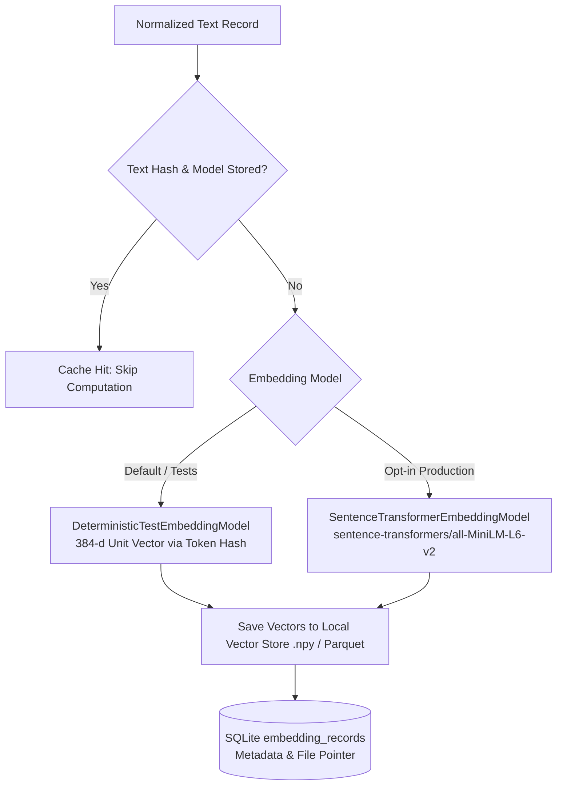

# Semantic Embeddings Architecture

## 1. Overview and Model Governance

The T20 Cricket Intelligence Platform utilizes a model-agnostic embedding interface designed for offline reproducibility, strict CPU execution, and zero data leakage to external paid APIs.



---

## 2. Model Specifications

### 2.1 Deterministic Test Double (`DeterministicTestEmbeddingModel`)
- **Identifier**: `test-deterministic-hash-384`
- **Dimension**: 384 dimensions (`float32`)
- **Flag**: `is_test_double = True` (Never disguised as real model weights).
- **Mechanism**: Deterministic token hash projection with bigram continuity, strictly L2-normalized ($\|v\|_2 = 1.0$).
- **Runtime**: Instant (< 1ms per 1,000 documents), 100% offline, zero disk space.
- **Handling of Edge Cases**: Empty or whitespace-only strings evaluate to zero vectors ($0.0$).

### 2.2 Optional Pre-Trained Dense Model (`SentenceTransformerEmbeddingModel`)
- **Model Identifier**: `sentence-transformers/all-MiniLM-L6-v2`
- **Revision / HuggingFace ID**: `sentence-transformers/all-MiniLM-L6-v2`
- **License**: Apache 2.0 (Permissive for academic and non-commercial research).
- **Architecture**: 6-layer BERT-MiniLM, 384-dimensional dense output embeddings with mean pooling.
- **Hardware Profile**:
  - Memory: ~120 MB RAM.
  - Disk Space: ~90 MB cached under `~/.cache/huggingface/hub/`.
  - CPU-first execution: ~15ms per paragraph on modern x86_64 CPUs.
- **Offline Protocol**: Requires explicit operator opt-in (`--model sentence-transformers/all-MiniLM-L6-v2`). Ordinary unit tests NEVER download model weights over the internet.

---

## 3. Storage Architecture: Decoupled Columnar & Relational Layer

Dense 384-float vectors are not stored directly as unbounded SQLite BLOBs. Instead, the platform uses a hybrid storage architecture:

1. **Relational Index** (`embedding_records` table in SQLite Schema v4):
   - Stores metadata: `embedding_id`, `norm_id`, `source_type`, `model_version`, `dimension`, `text_hash`, `is_test_double`, `vector_file_path`, `vector_index`.
2. **Columnar / Array Cache** (`data/processed/embeddings/vectors_*.npy` or partitioned Parquet):
   - Dense matrices stored in contiguous binary arrays for vector math and cosine similarity ranking.

---

## 4. Idempotency and Invalidation Protocol

1. Before computing an embedding, the pipeline computes `SHA-256(clean_text)`.
2. If `(norm_id, model_version)` exists in `embedding_records` with matching `text_hash`, the record is skipped as a cache hit.
3. If the underlying normalized text changes, the SHA-256 hash changes, triggering re-computation.
4. If a different model is selected (e.g. switching from `test` to `all-MiniLM-L6-v2`), new records are computed without overwriting prior model records.

---

## 5. CLI Usage

To preview embedding operations without database writes:
```powershell
python -m src.pipeline embed-text --dry-run
```

To run embedding generation across all eligible texts using the deterministic test double:
```powershell
python -m src.pipeline embed-text --all --model test
```

To filter by source type:
```powershell
python -m src.pipeline embed-text --source-type article_paragraph
```
