# Phased Implementation Roadmap: T20 Cricket Intelligence Platform

## 1. Roadmap Architecture & Progression Gates

The project is executed in 9 discrete, verifiable phases (Phase 0 through Phase 8). Progression from one phase to the next requires satisfying formal **Completion Gates** and recording progress in [SESSION_JOURNAL.md](file:///c:/Users/Ritesh%20Panda/OneDrive/Desktop/atsma_lab/docs/SESSION_JOURNAL.md).

```mermaid
gantt
    title T20 Cricket Intelligence Implementation Phases
    dateFormat  X
    axisFormat  Phase %s

    section Initialization & Research
    Phase 0 - Blueprint & Specifications       :active, p0, 0, 1
    Phase 1 - Repository Audit & Quarantine     :p1, 1, 2

    section Foundations & Data Pipeline
    Phase 2 - Canonical Schemas & Adapters     :p2, 2, 3
    Phase 3 - Ingestion & Extraction Engine    :p3, 3, 4

    section NLP & Model Intelligence
    Phase 4 - Cricket NER & Sentiment Engine   :p4, 4, 5
    Phase 5 - Clustering & Topic Modeling      :p5, 5, 6
    Phase 6 - Media-to-Match Event Alignment   :p6, 6, 7

    section Delivery & Polish
    Phase 7 - FastAPI & React Dashboard        :p7, 7, 8
    Phase 8 - Comprehensive Tests & Deployment :p8, 8, 9
```

---

## 2. Phase-by-Phase Execution Plan

### Phase 0: Project Initialization & Architectural Specifications (CURRENT)
- **Scope**:
  - Establish project directory structure, `.gitignore`, `.env.example`, and baseline documentation suite.
  - Detail system architecture, data models, research questions, evaluation methodology, and security policy.
- **Completion Gate**:
  - All 12 required markdown specifications completed and cross-linked.
  - Zero unvetted dependencies or scrapers executed.
  - Ready to receive the curated open-source repository URL list.

### Phase 1: Repository Ingestion, Audit & Isolation
- **Scope**:
  - Receive upstream repository URLs from the user.
  - Clone into quarantined local directory `research_sources/` (git-ignored).
  - Inspect commit hashes, licenses, dependency trees, and architecture.
  - Populate [SOURCE_REGISTER.md](file:///c:/Users/Ritesh%20Panda/OneDrive/Desktop/atsma_lab/docs/SOURCE_REGISTER.md) and audit cards in [REPOSITORY_AUDITS.md](file:///c:/Users/Ritesh%20Panda/OneDrive/Desktop/atsma_lab/docs/REPOSITORY_AUDITS.md).
  - Assign explicit decisions: `REUSE`, `ADAPT`, `REFERENCE ONLY`, `REJECT`.
- **Completion Gate**:
  - Every candidate repo has a documented 5-pillar audit score and rationale.
  - No rejected or high-risk code imported into `src/`.

### Phase 2: Canonical Schemas & Source Adapters
- **Scope**:
  - Implement Pydantic v2 data models in `src/models/`.
  - Implement SQLite/PostgreSQL DDL and SQLAlchemy bindings.
  - Build `BaseSourceAdapter` abstract base class and rate limiter.
  - Ingest local Cricsheet match files (ICC Men's T20 World Cup 2024 / 2022).
- **Completion Gate**:
  - Unit tests confirm valid Cricsheet JSON parsing into canonical `MatchRecord` and `DeliveryRecord`.
  - Schema validation rejects malformed test fixtures with zero false negatives.

### Phase 3: Polite Acquisition & Extraction Engine
- **Scope**:
  - Implement Trafilatura-based news extraction pipeline in `src/adapters/`.
  - Implement commentary stream parser.
  - Add idempotent SHA-256 deduplication and SQLite checkpointing.
  - Enforce `robots.txt` checking and token-bucket rate limiting.
- **Completion Gate**:
  - Ingestion run crawls sample news articles and commentary without duplicates.
  - Simulated network failure triggers exponential backoff and graceful recovery.

### Phase 4: Cricket NER, Entity Resolution & Sentiment
- **Scope**:
  - Build curated cricket gazetteer (`config/gazetteer.yaml`) covering T20 World Cup squads, venues, and acronyms.
  - Implement spaCy entity matcher and fuzzy alias resolver in `src/nlp/entity_resolver.py`.
  - Implement cricket-aware aspect sentiment analyzer.
  - Compute sentence embeddings using local `SentenceTransformer`.
- **Completion Gate**:
  - Test set achieves >85% Entity Resolution Accuracy on ambiguous names.
  - Directional sentiment accuracy verified on bowling vs. batting event fixtures.

### Phase 5: Clustering & Topic Modeling Benchmarking
- **Scope**:
  - Build modular model runner in `src/clustering/`.
  - Execute comparative experiments:
    1. TF-IDF + K-Means
    2. SentenceTransformer + K-Means
    3. SentenceTransformer + UMAP + HDBSCAN
    4. BERTopic with c-TF-IDF
  - Evaluate News and Commentary corpora independently.
- **Completion Gate**:
  - Intrinsic metrics (Silhouette, Davies-Bouldin, Coherence, Outlier rate) logged in `benchmark_results.json`.
  - Selection of optimal topic representation model justified by empirical evidence.

### Phase 6: Cross-Source Event Alignment & Attention Indexing
- **Scope**:
  - Implement hybrid event alignment engine in `src/analytics/alignment.py`.
  - Link news paragraphs to exact match deliveries using entity, temporal, and semantic scores.
  - Compute Attention-to-Performance Ratio ($APR$) for tournament players.
- **Completion Gate**:
  - Evaluated on gold-standard alignment set: Precision@1 > 0.80, Recall@3 > 0.90.
  - Every link outputs human-readable supporting evidence.

### Phase 7: FastAPI Service & Interactive Dashboard
- **Scope**:
  - Build FastAPI analytical endpoints (`/api/tournament`, `/api/topics`, `/api/matches`, `/api/alignment`, `/api/provenance`).
  - Build modern React + TypeScript + Vite dashboard.
  - Views: Tournament Overview, Topic Explorer (UMAP scatter), Match Timeline with grounded commentary, and Player Attention vs. Performance radar charts.
- **Completion Gate**:
  - Dashboard loads tournament data smoothly, allows interactive topic filtering, and renders clickable provenance evidence down to original delivery IDs.

### Phase 8: End-to-End Validation, Packaging & Documentation
- **Scope**:
  - Complete Pytest test suite with coverage report.
  - Finalize `LICENSES.md` recording all third-party attributions.
  - Validate clean-room setup from scratch via documented `README.md` instructions.
- **Completion Gate**:
  - 100% passing tests.
  - Clean local installation verified with zero undocumented dependencies.
