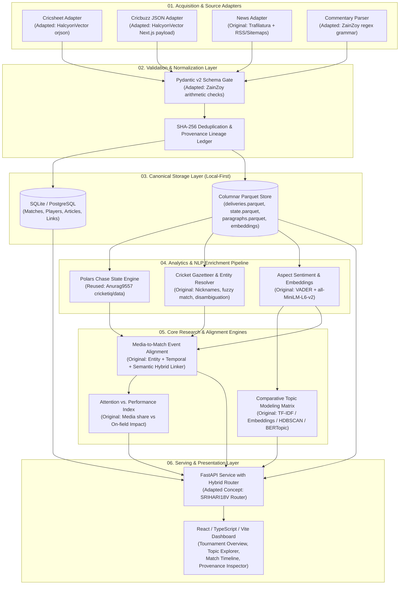

# Integration Architecture: Unified T20 Cricket Intelligence Platform

## 1. Architectural Philosophy & Cohesion

The primary objective is **not** to run several disparate projects side-by-side or create an unmaintainable Frankenstein patchwork. 

Instead, this integration architecture designs **one unified, local-first platform** built around:
1. Canonical Pydantic schemas acting as strict type contracts.
2. Best-of-breed algorithms extracted, adapted, and sanitized from audited repositories.
3. Original research engines (Topic Modeling, Media-to-Match Alignment, Attention vs. Performance) bridging unstructured media with structured facts.

---

## 2. Integrated System Blueprint

---

## 3. Module Integration Mapping & Source Provenance

| Pipeline Stage | Target Implementation Module | Origin / Reused Logic | Modifications & Hardening Required |
| :--- | :--- | :--- | :--- |
| **01A. Cricsheet Ingestor** | `src/adapters/cricsheet_adapter.py` | Adapted from `HalcyonVector` (`cil_etl/parse.py`) | Convert dataclasses to canonical Pydantic models; enforce UTC timestamps; output directly to `deliveries.parquet` and `matches.parquet`. |
| **01B. Cricbuzz Commentary** | `src/adapters/cricbuzz_adapter.py` | Adapted from `HalcyonVector` (`serve.py`) | Extract Next.js streaming JSON parser; add token-bucket rate limiter (0.33 RPS); remove bespoke HTTP server. |
| **01C. Commentary Grammar** | `src/adapters/commentary_parser.py` | Adapted from `ZainZoy` (`src/parser/commentary_parser.py`) | Extract regex grammar and scoring conventions; refactor into standalone parser returning canonical `CommentaryRecord` objects. |
| **01D. News Crawler** | `src/adapters/news_adapter.py` | **Original Implementation** | Polite crawler using Trafilatura for article body extraction; sitemap parser; `robots.txt` enforcement. |
| **02A. Validation Gate** | `src/models/validation_gate.py` | Adapted from `ZainZoy` (Module 14) & `Anurag9557` (`test_verify.py`) | Cross-check batting scorecards, extras sums, and dismissal counts. Reject corrupt records before storage. |
| **03A. State Engine** | `src/analytics/state_builder.py` | **Reused from Anurag9557** (`cricketiq/data/state_builder.py`) | Vectorized Polars computation of chase states (runs needed, balls remaining, current/required RR). MIT attribution preserved. |
| **04A. Entity Resolver** | `src/nlp/entity_resolver.py` | **Original Implementation** | Gazetteer covering T20 squads, player nicknames ("Boom Boom", "King Kohli"), fuzzy Levenshtein matching, and squad-based contextual disambiguation. |
| **04B. Aspect Sentiment** | `src/nlp/sentiment_engine.py` | Original + ZainZoy baseline | VADER / transformer sentiment tuned to cricket events; distinguishes bowler success from batter failure. |
| **05A. Topic Modeling** | `src/clustering/topic_runner.py` | **Original Implementation** | 4-model comparative runner: TF-IDF + K-Means, Sentence Embeddings + K-Means, HDBSCAN, and BERTopic. |
| **05B. Event Alignment** | `src/analytics/event_aligner.py` | **Original Implementation** | Hybrid scoring: Entity Jaccard + Temporal Proximity + Vector Cosine + Event Keywords linking news paragraphs to delivery sequences. |
| **05C. Attention Index** | `src/analytics/attention_index.py` | **Original Implementation** | Attention-to-Performance Ratio ($APR$) evaluating media narrative amplification. |
| **06A. Query Service** | `src/api/service.py` | Original + Router concept (`SRIHARI18V`) | FastAPI endpoints with automatic query routing between structured SQL stats and unstructured topic/narrative embeddings. |
| **06B. Dashboard** | `frontend/` | Original (React + TypeScript + Vite + Tailwind) | Polished sports intelligence interface with 2D UMAP topic scatter, match delivery timeline, and clickable provenance inspector. |

---

## 4. Module Boundaries & Typed Interface Contracts

All modules communicate exclusively through validated Pydantic v2 schemas:

1. **`RawHarvestRecord`** $\longrightarrow$ Ingestion to Extraction:
   Contains `source_name`, `url`, `raw_html_or_json`, `harvest_timestamp_utc`, and `http_headers`.
2. **`ArticleRecord`** & **`CommentaryRecord`** $\longrightarrow$ Extraction to Storage:
   Contains parsed headline, body text, canonical UTC timestamp, author, and `content_hash_sha256`.
3. **`MatchRecord`** & **`DeliveryRecord`** $\longrightarrow$ Cricsheet Adapter to Analytics:
   Contains match ID, teams, venue, outcome, over, ball, batter, bowler, runs, extras, and wicket attributes.
4. **`EventAlignmentRecord`** $\longrightarrow$ Alignment Engine to API & Dashboard:
   Contains `paragraph_id`, `match_id`, `over_window_start`, `over_window_end`, `confidence_score`, and `supporting_evidence` breakdown.

---

## 5. Security & Licensing Compliance Strategy

1. **Attribution Notices**:
   Create `LICENSES.md` incorporating full MIT copyright notice for `Anurag9557/cricket-iq` and attribution notices for adapted logic from `HalcyonVector` and `ZainZoy`.
2. **Strict Isolation of Quarantined Clones**:
   `research_sources/` remains excluded in `.gitignore`. No unvetted third-party files are committed into the production repository.
3. **Zero License Violations**:
   `sst_cloud-solutions/h25-sports` is completely isolated and excluded from any code copying or asset distribution due to its `UNLICENSED` declaration.
