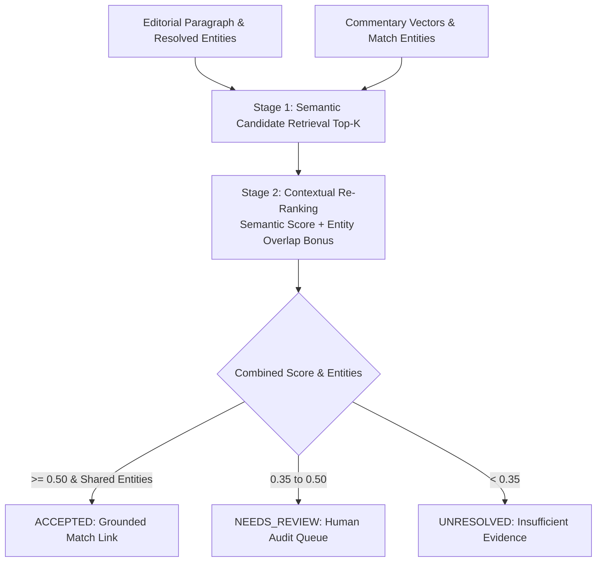

# Narrative Analysis, Event Alignment & Timeline Evolution

## 1. Overview and Core Principle

Semantic similarity alone is **not** sufficient proof that an editorial article and a commentary ball describe the same event. Two different matches can feature identical phrases like *"a brilliant yorker on off-stump"*.

The T20 Cricket Intelligence platform uses a **conservative two-stage retrieval and ranking protocol** and a **structured narrative timeline engine**.



---

## 2. Two-Stage Cross-Source Narrative Matching

### Stage 1: Candidate Retrieval
- Retrieves top-$K$ most similar commentary entries using dense vector cosine similarity (or sparse TF-IDF similarity).

### Stage 2: Contextual Re-Ranking & Gating
- Evaluates shared named entities (players, teams, match IDs) between the editorial paragraph and candidate commentary:
  $$\text{Score}_{\text{combined}} = 0.65 \times \text{Sim}_{\text{semantic}} + \text{Bonus}_{\text{entities}}$$
  where $\text{Bonus}_{\text{entities}} = \min(0.35, |\text{Entities}_{\text{shared}}| \times 0.175)$.
- Classification Thresholds:
  - `ACCEPTED`: Combined score $\ge 0.50$ AND at least one verified shared entity.
  - `NEEDS_REVIEW`: Combined score $\in [0.35, 0.50)$.
  - `UNRESOLVED`: Combined score $< 0.35$.
- Stored in `cross_source_matches` table with complete evidence JSON.

---

## 3. Match Milestone Synthesis & Event Alignment

The `EventAlignmentEngine` synthesizes ground-truth delivery records into discrete milestones:
1. **Wicket Events**: Bowler, dismissed batter, over number, and dismissal kind.
2. **Expensive Overs**: Overs yielding $\ge 15$ runs (momentum shifts).
3. **Death-Over Executions**: Overs 19 or 20 yielding $\le 4$ runs.
4. **Milestone Chases**: Fifties, centuries, and final ball finishes.

When an editorial paragraph discusses match moments, the engine cross-references the synthesized milestones using actors and cricket event keywords, generating explainable alignment confidence scores.

---

## 4. Structured Narrative Timeline

The `NarrativeTimelineEngine` constructs chronological trajectories tracking how coverage evolves:
- **Observed vs Inferred Timestamps**: Articles with verified publication dates (`published_at_utc`) increment `observed_timestamps_count`. Untimed or date-imprecise articles are placed into an explicit `unknown_date` bucket or date-level bucket without fabricating timestamps.
- **Timeline Dimensions Tracked**:
  - Publication volume (document count).
  - Sentiment baseline distribution (positive, neutral, negative ratio).
  - Mean sentiment score.
  - Dominant topic distribution per time bucket.
  - Top mentioned entities per time bucket.
  - Associated match events count.

> [!NOTE]
> Temporal correlation between high article volume and a match event does not establish causal proof. The timeline reports observed associations truthfully without unwarranted causal claims.

---

## 5. CLI Operations

To construct and view narrative evolution timelines:
```powershell
python -m src.pipeline narrative-timeline
```

To view cross-source alignment metrics and match statuses:
```powershell
python -m src.pipeline analysis-stats
```
