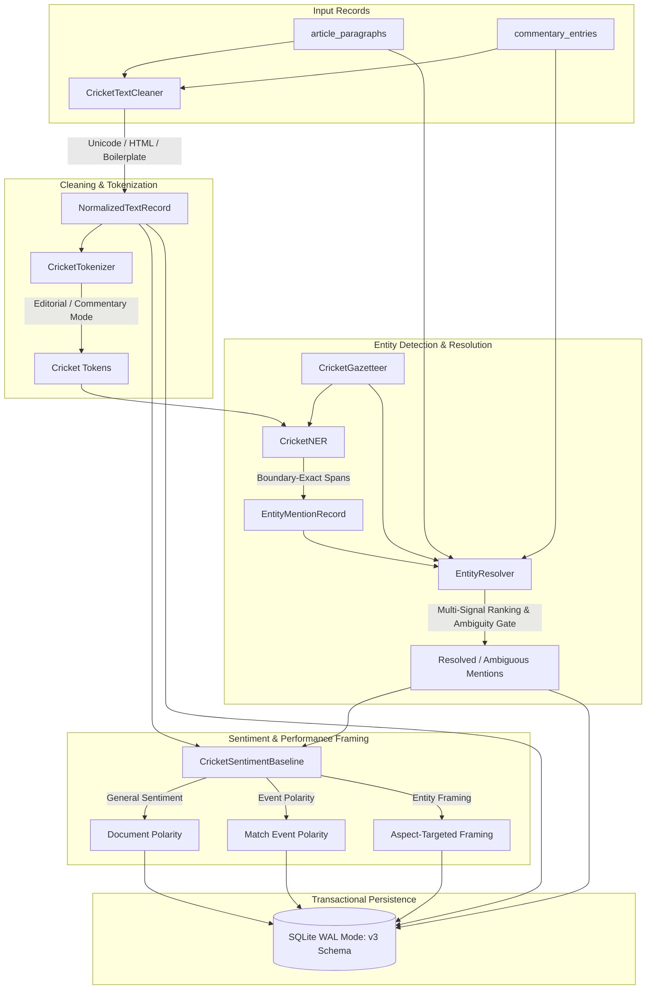

# Cricket Natural Language Processing (NLP) Pipeline

## 1. Overview & Architectural Principles

The **T20 Cricket Intelligence NLP Pipeline** is a modular, reproducible, CPU-first processing layer built under `src/nlp/`. It transforms raw, acquired cricket news articles, article paragraphs, ball-by-ball commentary, and structured player/team records into normalized, entity-linked, analysis-ready text representations.



### Core Invariants & Guarantees:
1. **Cricket Notation Preservation**: Cleaning and normalization strictly protect numbers, overs (`19.4`), scores (`182/5`, `45-2`), asterisk not-out markers (`82*`), acronyms (`DRS`, `LBW`), player initials (`V. Kohli`), and negation (`did not qualify`).
2. **Reversible Provenance**: Every normalized text record maintains a reversible reference to the raw source record (`source_type`, `source_id`, `original_text`, `char_count`).
3. **Idempotent Processing**: Running the NLP pipeline multiple times on unchanged records produces zero duplicates through deterministic primary keys and `ON CONFLICT DO UPDATE` upserts.
4. **CPU-First Offline Execution**: Zero reliance on paid third-party APIs, GPU servers, or cloud-based LLM endpoints. All tokenizers, gazetteers, and sentiment models execute deterministically on local CPU cores.

---

## 2. Component Layout & Directory Structure

```
src/nlp/
├── __init__.py                  # Package exports
├── schemas.py                   # Pydantic v2 schemas: NormalizedTextRecord, EntityMentionRecord, EntityResolutionRecord, SentimentBaselineRecord, NLPRunRecord
├── text_cleaner.py              # HTML unescaping, Unicode standardisation, boilerplate removal, notation preservation
├── cricket_tokenizer.py         # Boundary-exact tokenizer supporting overs, scores, compounds, and acronyms
├── gazetteer.py                 # Versioned entity registry loading YAML aliases and syncing with SQLite canonical tables
├── ner.py                       # Hybrid boundary-aware NER detecting exact surface spans and offsets
├── entity_resolver.py           # Multi-signal resolution (base fidelity + team context + ambiguity thresholding)
├── sentiment.py                 # Rule-based sentiment engine separating general polarity, event polarity, and entity framing
├── processing_pipeline.py       # End-to-end pipeline runner orchestrating batch processing and auditing
└── evaluation.py                # Evaluation module calculating precision, recall, F1, ambiguity rate, and macro-F1
```

---

## 3. Text Cleaning & Normalization Invariants

The `CricketTextCleaner` operates under strict domain preservation rules:
- Unescapes HTML entities (`&amp;` $\to$ `&`, `&quot;` $\to$ `"`, `&nbsp;` $\to$ space).
- Standardizes Unicode curly quotes (`’`, `“`, `”`) to standard ASCII quotes without corrupting diacritics on player names.
- Strips journalistic boilerplate ("Also Read", "Click here to subscribe", newsletter promotions) while leaving commentary lines intact.
- Never removes digits or punctuation required for cricket facts.

### Verified Preservation Benchmarks:
- `19.4 Bumrah to Kohli, SIX!` $\to$ preserved completely.
- `India need 12 runs from 6 balls.` $\to$ preserved completely.
- `Kohli scored 82* from 53 balls.` $\to$ preserved completely.
- `The decision was overturned after DRS.` $\to$ preserved completely.
- `India did not qualify for the final.` $\to$ negation preserved intact.

---

## 4. Cricket-Aware Tokenization Modes

The `CricketTokenizer` provides task-specific tokenization modes:

| Feature | `TokenizationMode.EDITORIAL` | `TokenizationMode.COMMENTARY` |
| :--- | :--- | :--- |
| **Target Text** | Journalistic paragraphs, match previews, review essays | Written ball-by-ball delivery entries |
| **Over Numbers** | Detected as `CRICKET_OVER` (`19.4`, `0.1`) | Detected as delivery index delimiter |
| **Score Strings** | Preserves `182/5`, `45-2`, `82*` as `CRICKET_SCORE` | Identifies boundary milestones |
| **Acronyms** | `T20`, `T20I`, `ODI`, `DRS`, `LBW`, `DLS`, `BCCI` | `FOUR`, `SIX`, `OUT`, `DRS`, `WIDE`, `NB` |
| **Compound Terms** | Multi-word expressions (`run out`, `not out`, `death overs`, `powerplay`, `super over`, `hat-trick`) | Retains delivery compound tags |

---

## 5. CLI Execution & Operational Commands

```bash
# 1. Run NLP pipeline on all unparsed paragraphs and commentary
python -m src.pipeline process-text --all

# 2. Run NLP pipeline with a limit for fast dry-run inspection
python -m src.pipeline process-text --all --dry-run --limit 20

# 3. View aggregated NLP counts, resolution rate, and sentiment distribution
python -m src.pipeline nlp-stats

# 4. Validate span offsets and relational foreign keys
python -m src.pipeline nlp-validate

# 5. Interactively resolve an entity surface form and view candidate ranking diagnostics
python -m src.pipeline resolve-entity --mention "King Kohli"
python -m src.pipeline resolve-entity --mention "Pandya"
```
