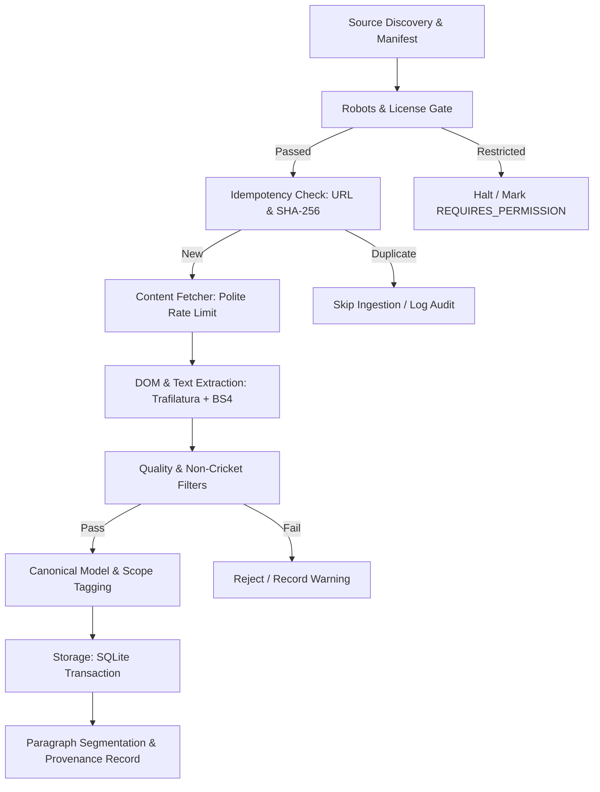

# Phase 9 Editorial Corpus Methodology & Quality-Controlled Ingestion Protocol

**Document Version**: 1.0.0 (Phase 9)  
**Date**: 2026-10-24  
**Scope**: Ingestion, Classification, Provenance, and Quality Assurance for Cricket Editorial Texts  

---

## 1. Overview & Architectural Principles

The T20 Cricket Intelligence Platform analyzes the relationship between media coverage and athletic performance. To prevent research bias and data corruption, the editorial ingestion pipeline enforces four fundamental separation invariants:

1. **Separation of Discovery from Acquisition**: URL discovery and manifest registration occur as an independent pre-step before downloading or extracting any article body.
2. **Separation of Retrieval Time from Publication Time**: A document's download timestamp (`retrieval_timestamp_utc`) must never be substituted for its actual revision or publication date (`published_at_utc`).
3. **Separation of Reference Texts from Journalistic Opinion**: Encyclopedic tournament overviews, squad rosters, and historical essays provide factual domain context but must not be treated as contemporary match journalism or opinion columns in framing and APDI analyses.
4. **Strict Scope and Match Linking Boundaries**: Multi-match or tournament-wide articles must not be artificially assigned to single matches.

---

## 2. Ingestion Pipeline Stages



### 2.1 Stage 1: Discovery and Manifest Registration
- URLs and source files are registered in a versioned manifest (`editorial_manifest.json` or `corpus_manifest.json`) prior to processing.
- The manifest registers:
  - `source_identifier`: Unique local file or slug identifier.
  - `canonical_url`: The authoritative, normalized HTTP/HTTPS address.
  - `publisher`: Legal provider organization.
  - `license_tag`: Permissive license or specific terms.
  - `content_type`: Categorization (`reference`, `news`, `expert_analysis`, `commentary`).
  - `document_scope`: Analytical boundary.

### 2.2 Stage 2: License and Technical Access Verification
- Automated requests verify:
  - Is the domain in the approved source register?
  - Does `robots.txt` permit crawling of the target path?
  - Does the license permit full-text retention and embedding?
- If any check fails, ingestion aborts immediately with status `REQUIRES_PERMISSION`.

### 2.3 Stage 3: Idempotency and Deduplication
- Storage engines check for existing records using:
  ```sql
  SELECT article_id FROM articles
  WHERE canonical_url = ? OR raw_content_hash = ?;
  ```
- If a matching canonical URL or identical SHA-256 hash exists, ingestion safely terminates without mutating historical database records or creating duplicate embeddings.

### 2.4 Stage 4: Metadata and Provenance Extraction
- Extracted fields:
  - `headline`: Title tag or OpenGraph title, stripped of site suffix.
  - `author`: Byline extracted from `<meta name="author">` or schema.org JSON-LD; `NULL` if anonymous or unstated.
  - `published_at_utc`: Extracted from ISO 8601 `<time datetime="...">` or HTTP `dc:modified` headers; `NULL` if unavailable.
  - `retrieval_timestamp_utc`: System UTC timestamp when bytes were received.
  - `content_hash_sha256`: Hex-encoded SHA-256 hash of the cleaned extracted body.

---

## 3. Explicit Document Taxonomy & Scoping

To prevent misattributing tournament-wide reporting to individual matches, every document is tagged with two mandatory taxonomy labels:

### 3.1 Content Type Taxonomy (`content_type`)
| Content Type | Definition | Permitted Analytical Use |
| :--- | :--- | :--- |
| `reference` | Retrospective, encyclopedic, or statistical records (e.g., Wikipedia tournament overview, squad list). | Entity resolution vocabulary, topic clustering baseline. Excluded from real-time framing shifts. |
| `news` | Contemporary reporting of match events, press conferences, and tournament occurrences. | Attention tracking, match-linked APDI, narrative alignment. |
| `expert_analysis` | Tactical essays, post-match punditry, and subjective opinion columns. | Framing analysis, APDI divergence evaluation. |
| `commentary` | Discrete ball-by-ball written action stream. | Micro-event alignment, excitement index. |
| `unknown` | Unclassified text document. | Minimum-evidence testing only. |

### 3.2 Document Scope Taxonomy (`document_scope`)
| Scope Label | Description | Allowed Match Linkage |
| :--- | :--- | :--- |
| `single_match` | Text exclusively reports on one specific cricket fixture. | Exactly 1 `linked_match_id` supported by score/venue evidence. |
| `multi_match` | Text analyzes two or more fixtures (e.g., Super 8 group review). | `linked_match_id = NULL`; match array recorded in metadata. |
| `tournament` | Text covers the entirety of a tournament or series. | `linked_match_id = NULL`. |
| `team_campaign` | Text chronicles a specific national team's progression over time. | `linked_match_id = NULL`; team tag populated. |
| `player_profile` | In-depth career retrospective or individual spotlight. | `linked_match_id = NULL`; player entity tag populated. |
| `historical_context` | Historical, geopolitical, or long-term rivalry context. | `linked_match_id = NULL`. |
| `unknown` | Unverified scope. | `linked_match_id = NULL`. |

---

## 4. Quality Control & Acceptance Gates

Every article candidate must pass the following programmatic gates before commit to `articles`:

1. **Length Gate**: Body text must contain $\ge 50$ words and $\ge 200$ characters of natural language prose. Short teasers and photo captions are rejected.
2. **Language Gate**: Text must be confirmed as English (`en`) via language detection heuristics.
3. **Boilerplate & Noise Filter**: Header navigation links, social sharing tags, and cookie disclaimers are stripped. Paragraphs with $< 25$ characters are discarded.
4. **Cricket Domain Validation**: The document must contain $\ge 3$ distinct cricket domain keywords (e.g., `wicket`, `over`, `innings`, `run`, `batting`, `bowling`, `pitch`, `crease`).
5. **No Synthetic or Fabricated Text**: All text must originate from verified external payloads. Generative AI hallucinations or mock documents are strictly barred from production databases.

---

## 5. Ingestion Plan for Future Licensed Journalism

When expanding to commercial journalism with proper authorization (e.g. The Guardian Content API):
1. User provides `GUARDIAN_API_KEY` via environment variable.
2. The `GuardianAdapter` calls official endpoints (`https://content.guardianapis.com/search?section=sport&tag=sport/cricket`).
3. Only articles with `type=article` and `productionOffice=uk` covering the World Cup window are retrieved.
4. Ingestion stores the article with `content_type='news'` and `license_tag='Guardian-OpenPlatform-Developer'`.
5. If no API key is provided, the ingestion tool exits cleanly without errors, logging `INFO: No external news API key configured; maintaining existing verified reference corpus.`
