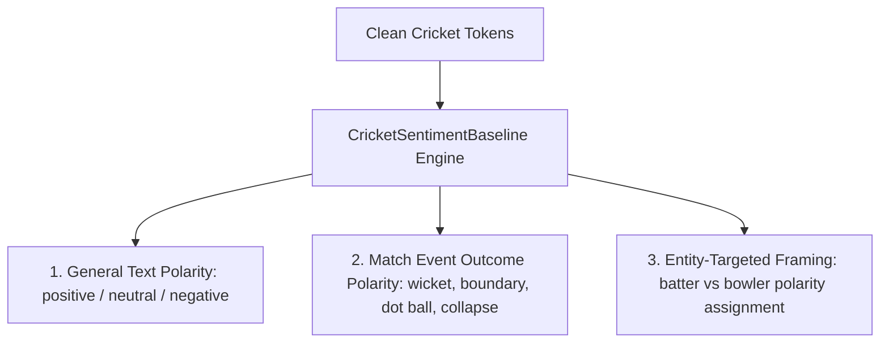

# Cricket Sentiment & Framing Baselines

## 1. Domain Challenge: Cricket Sentiment Polarity Inversion

Standard NLP sentiment tools (e.g., standard VADER, TextBlob, generic RoBERTa models) fail on cricket prose because core sports events possess opposing valence depending on perspective:

1. **Wickets**: A wicket is overwhelmingly **negative** for the batting team/batter (loss of resource, dismissal), but simultaneously **positive** for the bowling team/bowler (wicket-taking achievement, breakthrough).
2. **Boundaries (Fours/Sixes)**: Positive for the batting team, negative for the bowler.
3. **Domain Vocabulary**: Words like *"dominant"*, *"destructive"*, *"carnage"*, *"lethal"*, *"brutal"* describe superb cricket performances but are penalized by standard lexicons as violent or negative.
4. **Negation**: Sentences like *"India did not qualify for the final"* require negation scope detection to avoid scoring *"qualify"* as positive.

---

## 2. Three-Tier Baseline Architecture

The Phase 4 baseline cleanly isolates three distinct analytical dimensions:

### 1. General Sentiment
Measures standard journalistic tone using an interpretable cricket-aware lexicon scored on $[-1.0, +1.0]$.
- **Positive terms**: `brilliant`, `dominant`, `masterclass`, `superb`, `magnificent`, `unbeaten`, `clinical`, `flawless`.
- **Negative terms**: `collapse`, `disaster`, `dismal`, `shambles`, `blunder`, `erratic`, `struggled`, `choke`.

### 2. Match Event Outcome Polarity
Categorizes the objective cricket event described:
- **Wickets, dismissals, ducks, run outs**: Inherently negative for the batting side.
- **Boundaries (sixes, fours), half-centuries, centuries**: Inherently positive for the batting side.
- **Dot balls, maidens, tight overs**: Defensive pressure events.

### 3. Entity-Targeted Framing
When an entity mention is targeted:
- If target entity is a **bowler** and the event is a **wicket** or **maiden**, the framing polarity is positive ($+0.85$).
- If target entity is a **batter** and the event is a **wicket**, the framing polarity is negative ($-0.85$).
- If target entity is a **bowler** and the event is a **boundary conceded**, the framing polarity is negative ($-0.60$).

---

## 3. Negation and Counterfactual Handling

The engine employs a sliding 3-token negation window:
- **Negation triggers**: `not`, `no`, `never`, `didn't`, `did not`, `hasn't`, `failed to`, `neither`, `nor`, `without`.
- When a negation trigger precedes a sentiment term within 3 tokens, the valence is inverted and dampened:
  $$\text{Valence}_{\text{negated}} = -\text{Valence}_{\text{original}} \times 0.75$$
- Examples:
  - *"India did not qualify"* $\to$ `NEGATIVE` ($-0.60$)
  - *"Not out"* $\to$ `POSITIVE` ($+0.60$)

---

## 4. Persisted Baseline Schema (`sentiment_baselines`)

Every sentiment analysis output persists full explainability attributes:
- `sentiment_id`: Stable deterministic ID `sent_{sha256(source_id + target_entity)[:16]}`.
- `source_type`: `article_paragraph` or `commentary`.
- `source_id`: Source record identifier.
- `target_entity_id`: Canonical player or team ID (or `None` for document-level).
- `sentiment_label`: `POSITIVE`, `NEUTRAL`, or `NEGATIVE`.
- `compound_score`: Continuous value in $[-1.0, +1.0]$.
- `framing_type`: `general_editorial`, `batting_outcome`, or `bowling_outcome`.
- `evidence_tokens_json`: Array of exact tokens that triggered the scores.
- `rules_applied_json`: Array of rules executed (e.g., `["negation_detected", "wicket_bowler_inversion"]`).
- `model_version`: Exact engine version string (e.g., `cricket_lexicon_baseline_v1`).

---

## 5. Explicit Baseline Declaration

> [!NOTE]
> All sentiment outputs in Phase 4 are **interpretable heuristic baselines**, designed to provide an auditable rule-based prior for Phase 5 topic alignment and media-versus-performance analytics. They are not claimed to be scientifically calibrated emotional measurements.
