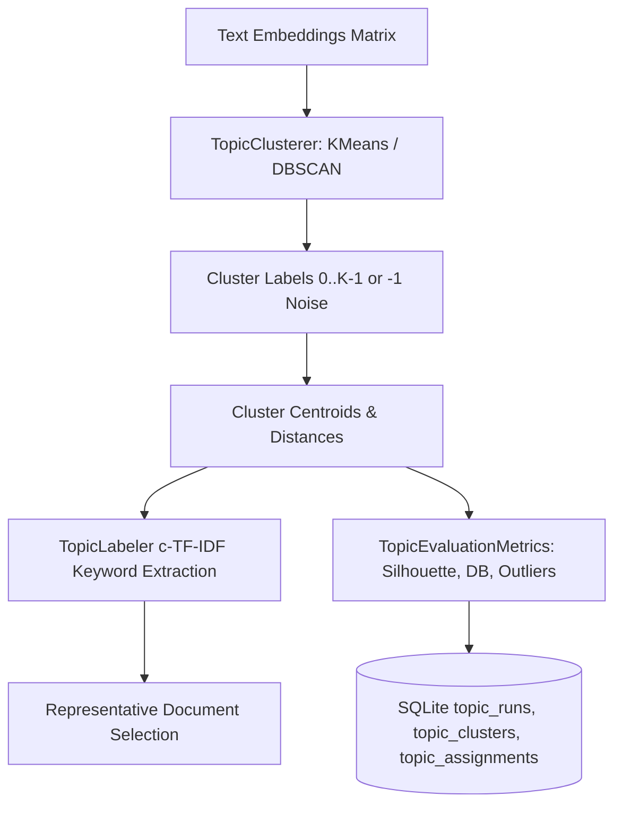

# Topic Discovery & Clustering Architecture

## 1. Overview and Problem Statement

Cricket prose consists of recurring tactical and journalistic themes (e.g. powerplay collapses, death-over yorker execution, DRS controversy, spinners exploiting dry surfaces). 

The platform implements modular topic discovery supporting:
1. **Sparse Lexical Baseline**: TF-IDF unigram and bigram representation preserving cricket terms.
2. **Dense Semantic Clustering**: K-Means baseline and DBSCAN for density-based clustering with explicit outlier/noise detection.
3. **Class-Based TF-IDF (c-TF-IDF)**: Extracting salient, human-readable keywords for each cluster.



---

## 2. Sparse TF-IDF Baseline (`src/analysis/tfidf_baseline.py`)

Before introducing dense clustering, an interpretable TF-IDF baseline was implemented to measure lexical overlap.
- **Cricket Token Pattern**: `r"(?u)\b\d{1,3}\*(?!\w)|\b\d{1,2}\.\d\b|\b\d{1,3}/\d{1,2}\b|\b\w+\b"`
- Strictly preserves:
  - Deliveries and overs: `19.4`, `0.1`
  - Match scores: `182/5`, `45-2`
  - Not-out indicators: `82*`
  - Abbreviations: `DRS`, `LBW`, `DLS`, `T20`, `T20I`

### Evaluation Comparison: TF-IDF vs Dense Embeddings
- **Exact Match Event Descriptions**: When articles describe the exact same event using shared match terms (`"Bumrah 19.4 head yorker"`), TF-IDF performs with high precision.
- **Paraphrased / Tactical Themes**: When articles discuss similar tactical narratives using different words (e.g., *"disciplined bowling at the backend"* vs *"clinical death-over execution"*), dense semantic embeddings outperform lexical TF-IDF by mapping to proximate points in vector space.

---

## 3. Clustering Algorithms & Noise Handling

### 3.1 K-Means (Controlled Baseline)
- Partitions vector space into $K$ spherical clusters.
- Configurable $K$ and fixed `random_state=42` guaranteeing reproducible cluster assignments across test runs.
- Handles small corpora (if $N < K$, sets effective $K = N$).

### 3.2 DBSCAN (Density-Based Outlier Detection)
- Clusters dense neighborhoods based on cosine distance (`metric="cosine"`, configurable `eps`, `min_samples=2`).
- Identifies isolated, idiosyncratic editorial opinions as noise points (`cluster_index = -1`).
- Preserves noise ratio: documents marked $-1$ are explicitly labeled `"Outliers / Noise"`.

---

## 4. Class-Based TF-IDF (c-TF-IDF) Keyword Extraction

To explain each discovered cluster:
1. All documents belonging to cluster $c$ are aggregated into a single text document.
2. Term frequencies $tf_{t, c}$ are calculated and weighted by inverse class frequency:
   $$W_{t, c} = tf_{t, c} \times \log\left(1 + \frac{A}{f_t}\right)$$
   where $A$ is the average number of words per cluster and $f_t$ is the word frequency across all clusters.
3. Top terms form a human-readable cluster label (e.g. `bumrah-yorker-bowling`, `kohli-chase-boundaries`).
4. If a cluster has no salient terms or represents noise, it is labeled explicitly as `"Unlabelled Cluster"` or `"Outliers / Noise"`.

---

## 5. Representative Document Selection

For every cluster, the system identifies documents closest to the cluster centroid:
- Minimizes Euclidean distance: $\arg\min_{d \in C} \|v_d - \mu_C\|_2$.
- Stores top $M$ representative document IDs in `topic_clusters.representative_doc_ids_json` for provenance and human review.

---

## 6. CLI Usage

To cluster editorial articles:
```powershell
python -m src.pipeline cluster-topics --corpus editorial --k 5 --algorithm kmeans
```

To cluster ball-by-ball commentary:
```powershell
python -m src.pipeline cluster-topics --corpus commentary --k 5 --algorithm kmeans
```

To inspect evaluation metrics of recent clustering runs:
```powershell
python -m src.pipeline evaluate-topics
```
