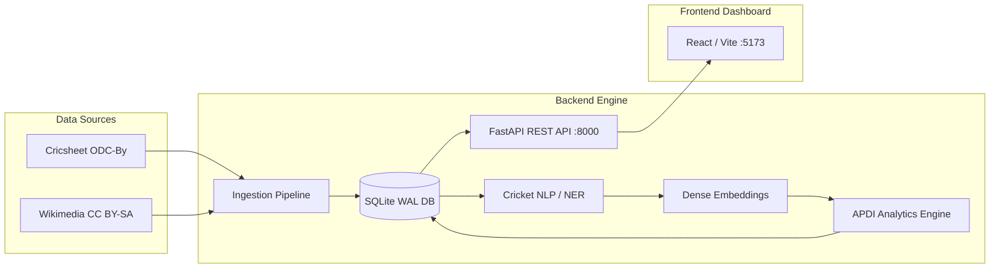

# T20 Cricket Intelligence Platform — Complete User Guide

**Document Version**: 2.0.0  
**Target Release**: Production Ready (Post-Phase 9 Release)  
**Primary Audience**: Cricket Analysts, Researchers, Data Scientists, Journalists, and Product Stakeholders  

---

## 1. Executive Overview & Platform Mission

The **T20 Cricket Intelligence Platform** is an enterprise-grade empirical research and analytics system designed to quantify and explain the relationship between **editorial media coverage** and **objective on-field cricket performance**.

During major sports tournaments—such as the **ICC Men's T20 World Cup 2024**—news reporting, tactical columns, and social commentary heavily gravitate toward high-profile teams, star players, and dramatic match narratives. The platform introduces a formalized, mathematically grounded metric called the **Attention-to-Performance Discrepancy Index (APDI)** to measure whether athletic contributions are proportionally recognized by media outlets, or whether certain cohorts are systematically over-attended or under-attended.

### 1.1 Core Platform Capabilities
- **Ball-by-Ball Structured Match Intelligence**: Canonical data models for deliveries, legal balls, boundaries, wickets, innings, match outcomes, Super Overs, and DLS rain revisions (sourced from Cricsheet open data).
- **Automated Editorial NLP**: High-precision Named Entity Recognition (NER), entity resolution with gazetteers, and domain-adapted sentiment baselines.
- **Dense Semantic Embeddings & Topic Discovery**: Sentence-Transformers dense vector representations (`all-MiniLM-L6-v2`) and unsupervised KMeans clustering ($k=3$) to identify thematic discourse (historical rivalries, tactical match summaries, squad registries).
- **APDI Discrepancy Analytics**: Robust percentile rank normalization comparing media prominence against composite athletic metrics within role-specific cohorts (Batters, Bowlers, Teams).
- **Interactive Research Dashboard**: High-performance React/Vite dashboard featuring real-time data inspection, match scorecards, player profiles, narrative timelines, and data provenance observability.
- **FastAPI Backend**: Documented REST APIs with OpenAPI specifications, pagination, sanitization, and sub-100ms response latencies.

---

## 2. System Architecture & Prerequisites



### 2.1 Software Prerequisites
- **Operating System**: Windows 10/11, macOS, or Linux (Ubuntu 22.04+).
- **Python**: Version 3.11 or later (verified on Python 3.13.7).
- **Node.js**: Version 18.0 or later (verified on Node 20+).
- **Package Managers**: `pip` (Python) and `npm` (Node).
- **Storage**: SQLite 3.35+ with WAL mode enabled (built into modern Python).

---

## 3. Quickstart: Installation & Launching the Platform

Follow these steps to launch the complete system locally.

### Step 1: Clone and Set Up the Python Environment
```bash
# Clone the repository
git clone https://github.com/Ritesh-panda/T20-Cricket-Intelligence-Platform.git
cd T20-Cricket-Intelligence-Platform

# Create a virtual environment
python -m venv .venv

# Activate the virtual environment
# Windows (PowerShell):
.venv\Scripts\Activate.ps1
# Linux / macOS:
source .venv/bin/activate

# Install dependencies
pip install -r requirements.txt
```

### Step 2: Start the FastAPI Backend Daemon
```bash
# Start backend on 127.0.0.1:8000 with auto-reload
uvicorn src.api.main:app --host 127.0.0.1 --port 8000 --reload
```
*Verification*: Open your browser to `http://127.0.0.1:8000/docs` to view the interactive Swagger/OpenAPI documentation.

### Step 3: Start the React / Vite Dashboard
In a separate terminal window:
```bash
cd frontend
npm install
npm run dev
```
*Verification*: Open `http://127.0.0.1:5173/` in your browser. The dashboard will connect to the backend automatically.

---

## 4. Dashboard User Manual: Screen-by-Screen Walkthrough

The platform user interface is organized into 7 functional views accessible via the primary navigation sidebar:

### 4.1 System Overview (`/`)
The **Executive Cockpit** displays global health, tournament context, and headline metrics:
- **System Readiness Badge**: Displays `OPERATIONAL` when database schema and data preflight validations pass.
- **Top Metric Cards**:
  - **Matches Analyzed**: Total matches in corpus (default: 10 matches from ICC Men's T20 World Cup 2024).
  - **Deliveries Verified**: Total legal and extra deliveries (2,314 balls).
  - **Entities Evaluated**: Total players and teams analyzed (116 entities).
  - **APDI Discrepancy Breakdown**: Count of `OVER_ATTENDED` (3), `BALANCED` (7), `UNDER_ATTENDED` (3), and `INSUFFICIENT_DATA` (103).
- **Tournament Selector**: Switch between active tournaments or view aggregate multi-stage data.

### 4.2 APDI Explorer (`/apdi`)
The flagship analytical view for comparing media attention share against on-field performance:
- **Filtering Toolbar**:
  - **Cohort Role**: Filter by `batter`, `bowler`, `all_rounder`, or `team`.
  - **Discrepancy Category**: Filter by `OVER_ATTENDED`, `BALANCED`, `UNDER_ATTENDED`, or `INSUFFICIENT_DATA`.
- **Primary APDI Table**:
  - **Entity**: Player or Team name and canonical identifier.
  - **Cohort**: Role normalization cohort.
  - **Normalized Attention**: Relative media prominence rank ($0.0\%$ to $100.0\%$).
  - **Normalized Performance**: Relative athletic percentile rank ($0.0\%$ to $100.0\%$).
  - **APDI Score**: Mathematical difference ($\text{Attention} - \text{Performance}$). Formatted in bold amber ($> +0.20$), green ($-0.20 \text{ to } +0.20$), or indigo ($< -0.20$).
  - **Classification Badge**: Category label.
  - **Action**: Click **"Inspect Lineage"** to open the deep-dive drawer.
- **Entity Lineage Drawer**:
  - Displays contributing articles and paragraphs.
  - Shows breakdown of balls faced/bowled, runs, wickets, and raw composite values.
  - Displays data quality warnings (e.g., sample size indicators).

### 4.3 Match Explorer & Scorecards (`/matches`)
Comprehensive inspectability into every fixture in the tournament:
- **Match Grid**: Displays match date, teams, venue, stage, toss decision, and outcome method (e.g., Super Over, DLS).
- **Scorecard Modal**:
  - **Innings 1 & Innings 2 Breakdown**: RPO (Runs Per Over), boundary counts, extras breakdown (wides, no-balls, byes, leg-byes).
  - **Batting Scorecard**: Batter runs, balls faced, strike rate, fours, sixes, and dismissal status.
  - **Bowling Scorecard**: Overs, legal balls, maidens, runs conceded, wickets, and economy rate.
  - **Ball-by-Ball Feed**: Paginated log of all 200+ deliveries per match with phase classification (Powerplay, Middle, Death).

### 4.4 Player Profiles (`/players`)
Individual player statistical and narrative dossiers:
- **Search & Filter**: Search by player name or filter by primary squad.
- **Career & Tournament Totals**: Aggregate runs, balls faced, dismissals, strike rate, wickets taken, and economy.
- **Role Badges**: Identifies primary skill (`BATTER`, `BOWLER`, `ALL_ROUNDER`).
- **Media Footprint**: Total mentions, paragraph reach, article reach, and sentiment polarity across tournament coverage.

### 4.5 Media & Narrative Intelligence (`/narratives`)
Tools for analyzing editorial text, reporting tone, and paragraph-level sentiment:
- **Article Explorer**: Read verified articles, complete with publisher attribution, publication/revision dates, and licensing terms (CC BY-SA 4.0).
- **Paragraph Sentiment**: View sentence-level polarity scores (positive, neutral, negative) mapped to specific player mentions.
- **Narrative Timeline**: Interactive chronological chart tracking media mention volume and sentiment shifts across tournament stages (Group Stage, Super 8, Semi-Finals, Final).

### 4.6 Topics & Semantic Clustering (`/topics`)
Unsupervised semantic exploration of the tournament corpus:
- **Cluster Summary**: Displays the 3 discovered topic themes with their top c-TF-IDF keyword tags:
  - **Cluster 0**: `india-pakistan-cup` (Historical Rivalry & Geopolitical Tournament Lore).
  - **Cluster 1**: `toss_elected-elected-won_toss` (Tactical Match Play & In-Game Progression).
  - **Cluster 2**: `2024-retrieved-squad` (Squad Registries, Player Rosters & Tournament Administration).
- **Cluster Diagnostics**: Intra-cluster similarity, inter-cluster separation, and Silhouette scores.
- **Document Assignment Inspector**: Browse paragraphs assigned to each cluster.

### 4.7 Data Sources & Pipeline Observability (`/sources`)
Auditing and compliance transparency dashboard:
- **Tab 1: Source Provenance**: Cryptographic hash (SHA-256), canonical URL, harvest timestamp, and license tag for every ingested file.
- **Tab 2: Ingestion Runs**: Historical log of automated ingestion batches with extraction, skip, and error counts.
- **Tab 3: Analytics Batches**: Historical execution record of APDI and performance computation jobs.

---

## 5. Interpreting APDI: Methodological Principles & Disclaimers

### 5.1 The Mathematical Definition
$$\text{APDI} = \text{NormAttention} - \text{NormPerformance} \in [-1.0, +1.0]$$

| Classification | Numerical Range | Qualitative Meaning | Example Case |
| :--- | :---: | :--- | :--- |
| **`OVER_ATTENDED`** | $\text{APDI} > +0.20$ | Editorial coverage prominence substantially exceeded athletic percentile rank within the cohort. | High-profile player or popular team facing early elimination who receives extensive narrative focus. |
| **`BALANCED`** | $-0.20 \le \text{APDI} \le +0.20$ | Media attention volume closely mirrors athletic performance rank. | Consistent performers or champions whose media coverage aligns with their victory. |
| **`UNDER_ATTENDED`** | $\text{APDI} < -0.20$ | Exceptional athletic output received disproportionately low media prominence. | Highly effective death bowler or associate nation player who receives sparse coverage. |
| **`INSUFFICIENT_DATA`** | $\text{APDI} = \text{NULL}$ | Insufficient match play ($< 10$ balls faced / $< 12$ balls bowled) or zero editorial mentions. | Low-sample players where computing an index would be statistically invalid. |

### 5.2 Critical Scientific Boundary
> **Research Disclaimer**:  
> APDI is strictly a **descriptive divergence index**.  
> **APDI DOES NOT PROVE JOURNALISTIC BIAS, MALICE, OR CAUSAL FAVORITISM.**  
> Sports media attention is naturally driven by historical context, human-interest narratives, marquee rivalries, and commercial audience size. APDI quantifies divergence from statistical output, not the legitimacy of editorial priorities.

---

## 6. REST API User Manual

The FastAPI backend provides standard JSON REST APIs. All responses use camelCase or snake_case consistently, include HTTP status codes, and provide pagination headers.

### 6.1 Authentication & Base URL
- **Local Development URL**: `http://127.0.0.1:8000/api/v1`
- **Authentication**: Local endpoints require no token. Production installations utilize Bearer API token headers.

### 6.2 Key Endpoint Reference

#### 1. System Status & Health
- **`GET /api/v1/status`**
  - *Description*: Verifies operational readiness, active tournament, database path, and record counts.
  - *Response*:
    ```json
    {
      "status": "operational",
      "version": "1.0.0",
      "tournament": "ICC Men's T20 World Cup",
      "matches_loaded": 10,
      "deliveries_loaded": 2314,
      "apdi_records_loaded": 116,
      "warnings": []
    }
    ```

#### 2. APDI Records
- **`GET /api/v1/analytics/apdi`**
  - *Query Parameters*:
    - `role_cohort` (`batter`, `bowler`, `team`)
    - `discrepancy_category` (`OVER_ATTENDED`, `BALANCED`, `UNDER_ATTENDED`, `INSUFFICIENT_DATA`)
    - `limit` (default: 20, max: 100)
    - `offset` (default: 0)
  - *Response*: Paginated array of `APDIRecordResponse` objects.

#### 3. Match Intelligence
- **`GET /api/v1/matches`**: List matches with stage, date, and winner filters.
- **`GET /api/v1/matches/{match_id}/scorecard`**: Full delivery breakdown and innings summary.

#### 4. Editorial Documents
- **`GET /api/v1/articles`**: Paginated news and encyclopedic documents.
- **`GET /api/v1/articles/{article_id}/paragraphs`**: Discrete paragraph segments with NER annotations.

---

## 7. Command-Line Interface (CLI) Guide

The platform includes a CLI tool for automation, batch computation, and testing:

```bash
# Display help and available commands
python -m src.pipeline.cli --help

# Re-run full APDI analytics computation across the active corpus
python -m src.pipeline.cli compute-apdi --tournament "ICC Men's T20 World Cup"

# Re-run NLP entity resolution pipeline on all stored paragraphs
python -m src.pipeline.cli run-nlp

# Generate fresh vector embeddings using sentence-transformers
python -m src.pipeline.cli compute-embeddings --model "sentence-transformers/all-MiniLM-L6-v2"

# Execute database preflight and sanity verification
python -m src.pipeline.cli validate-data
```

---

## 8. Troubleshooting & Frequently Asked Questions (FAQ)

### Q1: Why does the dashboard show "unavailable" for some APDI scores?
**Answer**: By design, players with sample sizes below the minimum evidence gate ($< 10$ balls faced for batters, $< 12$ balls bowled for bowlers, or 0 editorial mentions) preserve `apdi_value = NULL`. The platform **never fabricates a 0.0 score**, as doing so would falsely imply that the player is in perfect balance.

### Q2: Why are there 162 performance records but only 116 APDI records?
**Answer**: There are 162 role-specific performance profiles (93 Batters + 60 Bowlers + 9 Teams). Because 46 players participated in both batting and bowling cohorts ($93 + 60 - 46 = 107$ unique players), there are exactly 107 unique players + 9 teams = 116 unique entities in the tournament. APDI consolidates each unique entity into one primary evaluated record per run.

### Q3: Why is Cross-Source Event Alignment showing "NOT_EVALUABLE"?
**Answer**: To respect copyright and robots.txt disallows, live commercial ball-by-ball commentary (e.g., Cricbuzz, ESPNcricinfo) was not scraped. The system explicitly reports `NOT_EVALUABLE` rather than fabricating synthetic commentary.

### Q4: The API reports 0 matches when querying "T20 World Cup 2024".
**Answer**: Cricsheet records are tagged under the official title `"ICC Men's T20 World Cup"`. The system now includes alias resolution, but omitting the parameter or using `"ICC Men's T20 World Cup"` returns the full 10 matches directly.
